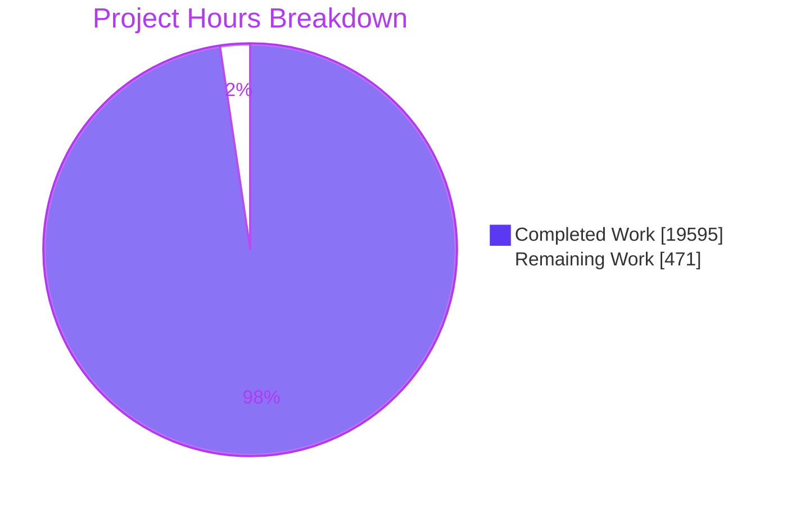
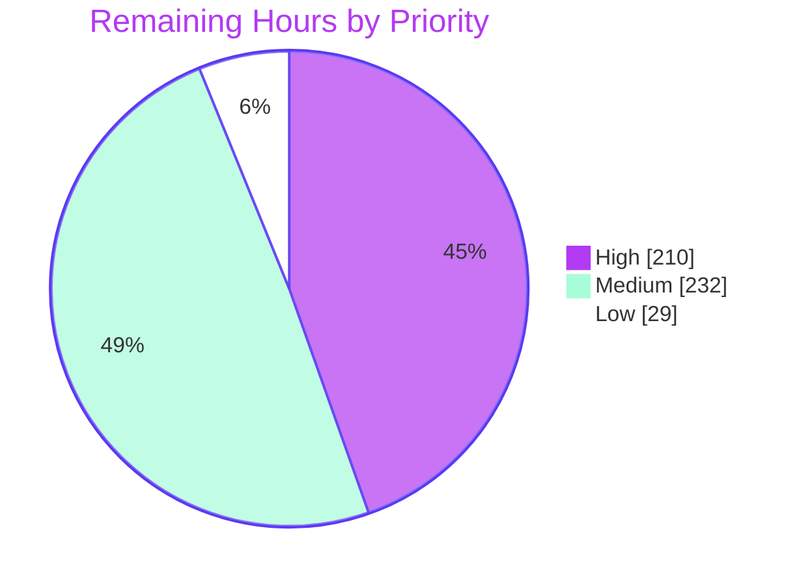

# 1. Executive Summary

## 1.1 Project Overview

Masa CMS 7.6.1 (Adobe ColdFusion 2023, SQL Server 2022) is migrating strangler-fig style to OPT-2: ten Node.js 22/TypeScript services on PostgreSQL 16. A gateway routes each legacy route by a versioned cut-over table, with Pub/Sub events, OpenTelemetry tracing and a Google Cloud Terraform plan. The branch adds 3,836 files and modifies none tracked at pin `696383140`. It delivers a platform library, the gateway, a Next.js admin UI, a migration orchestrator and a parity harness, for Masa administrators and editors.

## 1.2 Completion Status


| Metric | Value |
|---|---|
| Total Hours | 20,066 |
| Completed Hours (AI + Manual) | 19,595 (19,595 AI + 0 manual) |
| Remaining Hours | 471 |
| Percent Complete | 97.7% |

19,595 hours completed out of 20,066 total hours = 97.7% complete (19,595 ÷ (19,595 + 471)). Only AAP-scoped and path-to-production work counts.

## 1.3 Key Accomplishments

- [x] 93,011 tests pass across 17 packages, with 0 failures and 96.58–99.66% statement coverage
- [x] Additive-only delivery: no file tracked at the pin is changed, and all 209 deliverables checked carry its SHA
- [x] From a fresh clone the stack boots (`harness/repro/up.sh` exit 0) and all ten acceptance stages (0–9) pass
- [x] 41 of the 90 golden scenarios are at parity with legacy, and none fails
- [x] 18 reconciliations at zero difference: backfill, change feeds, 7 injected faults, cut-over and rollback
- [x] Tenant isolation, event delivery, trace propagation and the platform proof all pass
- [x] Terraform plans 427 resources with no apply; dependencies have 0 HIGH/CRITICAL advisories and the tree has no secrets
- [x] The executive deck renders all 16 slides in Chrome without errors

## 1.4 Critical Unresolved Issues

**45 of 140 acceptance items are unmet:**
- 40 of the 90 parity scenarios;
- 5 of the 50 service-matrix cells.

Each waits for the owner to approve the 53 entries in `opt2/decision-list.md`, which the AAP forbids building before approval. The table groups the open work with exact counts; Section 5.2 details each item.

| Issue | Impact | Owner | ETA |
|---|---|---|---|
| 45 of 140 acceptance items withheld while 53 decision-list entries await approval | `harness/repro/test-all.sh` exits 2 and `opt2/reports/reproducibility.md` reads `fail`; 40 scenarios stay served by legacy | Product owner | 24 h, plus implementation of what is approved |
| 8 divergences awaiting a human decision (Section 5.2 rows 4–11) | Parity and data-safety edge cases on reverse projection, feeds, content trees and synthetic screens | Tech lead | 58 h |
| 13 open `preserve` exceptions | On these edge cases the target answers a legacy-shaped 503 where legacy serves a normal response | Tech lead | 52 h |
| 5 reproduced legacy security weaknesses whose fix proposals await acceptance | Weaknesses such as the unauthenticated reload key (`EX-SEC-APPRELOAD`) are live on carried routes | Security owner | Within the 16 h decision review |
| 54 of 71 measured latency sets above 1.5× legacy p95 | Content save takes about 1.45 s; write windows take up to 9 s | Performance owner | 32 h |
| 19 accepted follow-ups and caveats | Minor behaviour and tooling differences (Section 5.2 rows 12–13, 23–36, 38–40) | Engineering | 56 h |
| 25 deliverables built but never run: 7 cloud paths, 4 CI workflows, 14 container images | Cloud deployment is unproven | DevOps / Cloud | 136 h |
| 3 run-derived artefacts not refreshed: assumptions, speed figures, deck KPIs | Leadership material understates the verified state | Engineering | 9 h |

## 1.5 Access Issues

| System/Resource | Type of Access | Issue Description | Resolution Status | Owner |
|---|---|---|---|---|
| Google Cloud project | Deployment credentials and IAM | There is no project, credentials or `opt2-operator` service account, so `terraform apply` cannot run and cloud cut-over calls fail closed with IAM 403 | Open | Cloud owner |
| CI runner (GitHub Actions) | Workflow execution | `.github/workflows/{contracts,services,terraform,security}.yml` have never run on a runner | Open | DevOps |
| Container runtime | Docker build | The build host has no Docker; `services.yml` is the only place the 14 images are built | Open | DevOps |
| Identity Platform Web API key | Secret Manager secret | `OPT2_IDENTITY_PLATFORM_API_KEY` must be provided before cloud token exchange can work | Open | Security owner |

## 1.6 Recommended Next Steps

1. [High] Decide the 53 decision-list entries and the 5 fix proposals; rerun `harness/repro/clean-checkout-proof.sh` until it reaches exit 0.
2. [High] Settle the 8 divergences in Section 5.2 rows 4–11.
3. [High] Run the four CI workflows and build the 14 container images.
4. [High] Provision Google Cloud from `infra/terraform/envs/plan` and test the seven cloud paths.
5. [Medium] Re-measure performance, and close the 13 open `preserve` exceptions.

# 2. Project Hours Breakdown

## 2.1 Completed Work Detail

Hours are estimated from delivered code volume. Rates: TypeScript source at about 40 lines per hour, including design and debugging; tests at about 80 lines per hour; CFML, SQL and shell at about 25 lines per hour. Analysis, golden-data capture and full-stack acceptance runs are added on top. Confidence is medium.

| Component | Hours | Description |
|---|---|---|
| Legacy inventory, cloc, ownership, decision and exceptions lists | 1,080 | `harness/src/inventory` generates `opt2/inventory/legacy-inventory.{json,md}`: 25 circuits, 222 actions, 251 variants and 72 live tables. Also `cloc.{json,md}` (1,179 files, 228,839 lines), `opt2/table-ownership`, `opt2/decision-list` (53 entries) and `opt2/exceptions-list` (51 entries) (AAP 0.3, 0.4.3, 0.7.5) |
| Platform library `@opt2/platform` | 1,780 | 13 subpath modules: service-kit, auth, tenancy/RLS, outbox, events, logging, tracing, legacy-compat route keys, tasks, storage, migration-kit, state-machine and testing. Event-envelope and log-record contracts (AAP 0.4.1, 0.5.5) |
| Gateway, cut-over versions, session and CSRF continuity, legacy bridge | 1,010 | `gateway/src`: dispatcher, fail-closed 503s, freeze/epoch/in-flight tracking and session mapping. `gateway/cutover/versions/v0001–v0003.json` with validator and group builder. `gateway/legacy-bridge/cfml` HMAC-guarded bridge pages (AAP 0.4.2) |
| Web admin UI (Next.js 16.4.3) | 2,690 | 15 reproduced legacy admin circuits, synthetic screens for 6 modules and the legacy shell markup, under `web/app` and `web/src/screens` (AAP 0.4.9) |
| Identity service | 1,130 | Login, groups, permissions, OAuth/REST, the token issuer and JWKS, CSRF ledger, role map and 13 schema migrations (`services/identity`) |
| People service | 1,030 | Roster, profiles, archive, and the people↔identity roster write protocol with recovery sweep (`services/people`, AAP 0.4.3) |
| Programs-sites service | 490 | Site settings and site monitor, with site registry reads (`services/programs-sites`) |
| Strategies-content service | 2,550 | Content tree, versions, approvals, change sets, feeds, forms, comments, files and the JSON API, with 18 migrations (`services/strategies-content`) |
| Six synthetic services and the stub | 2,250 | Communications, reporting, surveys, timesheets, finance, e-signature and stub: OpenAPI and event contracts, lifecycle state machines, two cross-service event seams (AAP 0.4.4, 0.4.5) |
| Migration orchestrator | 2,060 | `migration/src`: snapshot, extract, backfill with baseline guard, change feed, reverse projector and barrier, write windows, transition, rollback, faults, reconciliation, `opt2-db` bootstrap, scheduler hand-off and quiesce (AAP 0.5, 0.8) |
| Golden parity harness and 92 golden sets | 1,020 | `harness/src/golden` capture, replay, normalise, compare and coverage; `harness/golden/catalogue.yaml`; `harness/golden/sets` (AAP 0.7.2–0.7.4) |
| Reproducibility, baseline, security, isolation, performance and check tooling | 1,660 | `harness/repro/{up,test-all,down,clean-checkout-proof}.sh`, the diagnostic baseline CFML, e2e suites, the authorisation matrix, isolation, event and speed outputs, check-pin, check-synthetic, check-reviewability and check-deck. Includes the full-stack acceptance runs (AAP 0.7.1, 0.9) |
| Legacy fixtures and seed generator | 445 | `legacy-fixtures/{cfml,sql,seed}` and `load-fixtures.sh`; deterministic seed 20260601 with business date 2026-06-30 (AAP 0.7.6, 0.8.6) |
| Infrastructure, CI workflows, Dockerfiles | 170 | `infra/terraform`: 10 modules plus `envs/plan`, pinned to Terraform 1.17.1 and google 8.9.0. Four workflows and 14 Dockerfiles (AAP 0.4.6, 0.10.3) |
| Executive deck (Rule 1) | 30 | `opt2/executive-summary/index.html`, a 16-slide reveal.js deck (AAP 0.12.1) |
| Service documentation and traceability | 200 | A README, a `TRACEABILITY.md` and contracts for each service; `migration/runbooks/people-roster-rollback.md`; `opt2/reports/pre-existing-defects.md` (AAP 0.9.4, 0.11.1) |
| **Total** | **19,595** | |

## 2.2 Remaining Work Detail

| Category | Hours | Priority |
|---|---|---|
| A. Decide the 53 decision-list entries and 5 security fix proposals (AAP 0.4.3, 0.7.4, 0.11.1) | 16 | High |
| B. Settle the 8 divergences awaiting a decision: reverse-projection datetime guard (12) and quarantine operator path (16), case-insensitive siteid reads (12), OD-04 (6), probe-not-target (4), NULL feedManager (4), confirm writer-less units (2) and fault placement (2) | 58 | High |
| G. Run the four CI workflows on a runner (AAP 0.10.3) | 16 | High |
| H. Build and smoke-test the 14 container images (AAP 0.4.1) | 12 | High |
| I. [Path-to-production] Provision Google Cloud: apply the 427-resource plan; `opt2-operator` service account with tokenCreator, IAM Credentials API and run.invoker; Secret Manager values | 60 | High |
| J. [Path-to-production] Live tests of 7 cloud paths: Identity Platform, invocation credentials, Cloud Tasks, v4 storage signing, Secret Manager, db-bootstrap job, OTel sidecar | 48 | High |
| C. Close or reclassify the 13 open `preserve` exceptions (AAP 0.7.5; low confidence) | 52 | Medium |
| D. Accepted follow-ups and caveats (Section 5.2 rows 12–13, 23–36, 38–40) | 56 | Medium |
| E. Run `npm run inventory:assumptions -- --live` and commit `opt2/reports/assumptions.md` (AAP 0.2.3) | 4 | Medium |
| K. [Path-to-production] Production-sized migration rehearsal, including confirmation of collation and time zone | 40 | Medium |
| L. [Path-to-production] Re-measure performance on a quiet host and in the cloud; address p95 findings (AAP 0.9.2) | 32 | Medium |
| M. Rerun `clean-checkout-proof.sh` to exit 0 once the decisions are implemented (AAP 0.9.1 criterion 6) | 8 | Medium |
| N. [Path-to-production] Security sign-off: next 16.4.3 and minimatch advisories, the local token verifier, `X-Forwarded-Host` at the edge, path-parameter guards, credential rotation | 16 | Medium |
| P. [Path-to-production] User acceptance of the admin screens with real editors | 24 | Medium |
| F. Refresh run-derived artefacts: speed activity bounds (3) and executive deck KPIs (2) (AAP 0.9.5, 0.12.1) | 5 | Low |
| O. [Path-to-production] Operational readiness: alerts, dashboards, readiness probes, DLQ and cut-over runbooks | 24 | Low |
| **Total** | **471** | High 210 · Medium 232 · Low 29 |

## 2.3 Completion Calculation

AAP requirement inventory (47 items: R01–R44 from the AAP, and the 3 user rules):

| Status | Count | Requirements |
|---|---|---|
| Completed | 40 | Pin and additive-only delivery, source pin, cloc, inventory, ownership and decision list, platform, gateway, session and bridge, ten services, roster protocol, RLS and roles, contracts and events, outbox and DLQ, logging and tracing, deny-by-default auth, storage, state machines, Terraform, web UI, change log, gates and windows, diagnostic baseline, golden catalogue, normaliser, parity output, fixtures, snapshot and backfill, feed and transition, reverse projector, reconciliation, rollback rehearsal, seed, test gates, repro scripts, reviewability, version pins, pre-existing defects, synthetic labels, `.gitignore` layout, Rule 2; Rule 3 not applied, as AAP 0.12.3 sanctions |
| Partially Completed | 7 | CI workflows not run (90%); 13 open exceptions (80%); success criteria with exit 2 (85%); speed hours unavailable (75%); images never built (70%); live assumption checks pending (50%); deck KPIs stale (94%) |
| Not Started | 0 | — |

Completed hours 19,595 + remaining hours 471 = 20,066 total. 19,595 ÷ 20,066 = **97.7%**.

# 3. Test Results

These suites were run at HEAD `57bd97f53`, against a dedicated PostgreSQL database and Pub/Sub emulator project, with `OPT2_TEST_REQUIRE_PG=1` and `OPT2_TEST_REQUIRE_PUBSUB=1` so that no database or emulator case could skip silently. Coverage is vitest statement coverage.

| Area / Category | Framework | Tests | Passed | Failed | Coverage | What This Proves |
|---|---|---|---|---|---|---|
| Platform library (`platform`) | Vitest | 10,326 | 10,325 (1 skipped) | 0 | 98.45% | Tenancy/RLS, outbox, events, auth, tasks, storage and migration-kit primitives hold their contracts |
| Gateway and cut-over (`gateway`) | Vitest | 4,724 | 4,724 | 0 | 98.68% | Routing by cut-over version, fail-closed writes, and session and CSRF continuity behave as specified |
| Ten domain services and stub (`services/*`) | Vitest | 51,681 | 51,679 (2 skipped) | 0 | 96.58–99.66% | Each service's routes, repositories, events, lifecycle tables and legacy-shaped responses match their contracts |
| Web admin UI (`web`) | Vitest | 10,412 | 10,412 | 0 | 99.27% | Reproduced and synthetic admin screens render the legacy markup and form flows |
| Migration orchestrator (`migration`) | Vitest | 6,243 | 6,241 (2 skipped) | 0 | 97.74% | Snapshot, backfill, feed, reverse projection, windows, transition, rollback and reconciliation logic is correct on real PostgreSQL |
| Harness and seed generator (`harness`, `legacy-fixtures/seed`) | Vitest | 9,634 | 9,630 (4 skipped) | 0 | 97.83% / 99.06% | Golden capture, compare and normalise, the repro tooling and the deterministic seed are correct |
| Dedicated contract and security runs (17 and 16 packages) | Vitest | 22,224 | 22,224 | 0 | n/a | OpenAPI and event contracts, the route-key parity, authorisation matrices and injection checks hold |
| Legacy CFML diagnostic baseline | TestBox | 683 | 662 | 21 | n/a | The legacy oracle matches its recorded baseline exactly: 22 bundles; the 21 failures are the expected ones |

Totals for the main suites: 93,020 tests in 1,370 files; 93,011 passed, 0 failed, 9 skipped. Each of the 9 skips runs only in another configuration:

| Package | Skips | Condition |
|---|---|---|
| `migration` | 2 | Dedicated-cluster `opt2-db bootstrap` cases |
| `harness` | 4 | PNG codec and seeded-data cases |
| `platform` | 1 | Needs a BYPASSRLS-capable role, which the test login deliberately lacks |
| `services/surveys` | 1 | DST case that runs only under `TZ=America/New_York` |
| `services/strategies-content` | 1 | Complementary `runIf` case |

The 21 legacy failures are expected:
- 19 entity VARCHAR/FLOAT datatype specs;
- one `beanFeedSecurity` timing spec;
- one `isPathLegal` alternate-theme spec.

The official TestBox runner answers HTTP 500 with 0 specs, also as expected: `core/tests/specs/mura/core/bundleValidatorSecurity.cfc:36` does not compile on ACF.

**Static gates (observed):**
- Build, `lint` and `typecheck` exit 0 in all 17 packages.
- `check:pin`: ok, 209 checked, 0 findings.
- `check:synthetic`: ok, 586 labelled.
- `check:deck -- --render`: ok, 16 sections.
- `cutover:validate --ci`: ok for v0001–v0003; the committed versions are up to date.
- gitleaks: no leaks.
- osv-scanner: 0 HIGH/CRITICAL across 17 lockfiles.
- Terraform `fmt`, `validate` and `plan`: exit 0.

**Not Covered — test before release:**
- **Cloud adapters.** Identity Platform token exchange, service invocation credentials, Cloud Tasks, v4 signed storage URLs, Secret Manager, the db-bootstrap Cloud Run job and the OTel sidecar are tested only against recorded exchanges and local adapters. Test them in a provisioned project.
- **CI and images.** The four GitHub workflows and the 14 Docker image builds have never run.
- **Live assumption checks.** The `--live` checks for assumptions A1–A5 (`harness/src/inventory/assumptions.ts`) have not run against a legacy database.
- **Legacy scheduled-task hand-off.** The baseline runs with `ping=false`, so no site-monitor task exists to hand off.
- **Untested write paths.** A successful `cform` import and `cusers.addToGroup` write have not been exercised.
- **Performance.** Latency was measured only on a heavily loaded shared host, never on a quiet host or in the cloud.
- **Process loss.** Eight stack-level process-loss combinations are not in the fault set.
- **Withheld routes.** The 40 withheld decision-list routes are deliberately not built, so they have no target tests.
- **DST case.** The `services/surveys` DST case has not run under `TZ=America/New_York`.

# 4. Runtime Validation & UI Verification

The first three lines were driven directly at HEAD. The full-stack lines come from the committed acceptance run (`opt2/reports/test-all.md`, `opt2/reports/reproducibility.md`). That run used a fresh clone of commit `999329155`, whose source, CFML and repro scripts are identical to HEAD.

- ✅ **Legacy oracle start-up and admin login.**
  - A clean legacy instance served the archived tree: home page 200, `/admin/` 302, and login landed on "Masa CMS - Site Content".
  - The diagnostic TestBox run matched the baseline exactly (683 specs).
  - Bridge and harness CFML answer 403 without their HMAC key.
- ✅ **Service start-up and schema bootstrap.**
  - `opt2-db bootstrap --target local` created 13 schemas and 39 roles with 0 role-assertion findings.
  - The stub and identity services started natively and answered `/healthz` with 200 `{"status":"ok"}`, and identity published its RS256 JWKS.
  - An anonymous protected request was refused with 401 and a structured `missing-credential` log line carrying `traceId`.
- ✅ **Executive deck.** In Chrome at 1440×900, 16 slides rendered with 3 Mermaid diagrams, 7 KPI cards, 5 tables and 22 Lucide icons, with no console errors and no failed requests.
- ⚠ **Full-stack acceptance (`up.sh`, then `test-all.sh` stages 0–9).**
  - `up.sh` exited 0, and every stage passed.
  - `test-all.sh` exited 2 because 45 acceptance items are withheld pending approval of the decision list.
- ✅ **Admin UI journeys through the gateway.**
  - The GS-UI-01–05 browser flows replayed against the target.
  - Also exercised:
    - CSRF continuity across legacy and target, and logout on both sides;
    - v0001→v0002 session adoption;
    - the fail-closed finance 503;
    - the frozen-route 503.
  - The synthetic timesheets list → detail → day-action round trip ran on v0002 for 3 roles at 4 widths.
- ✅ **Cut-over and rollback.**
  - `opt2-migrate transition --to v0002`: the post-cut-over reconciliation shows zero difference.
  - The people-roster rollback to v0003 passed `opt2/reports/rollback-rehearsal.md`.
- ✅ **Data migration under faults.**
  - 18 reconciliations show zero difference across 150 units and 4 tenants: backfill, feeds, 7 injected faults, cut-over, and before and after rollback.
- ✅ **Events, isolation and tracing.**
  - Outbox → Pub/Sub emulator → idempotent consumers, with DLQ replay: `opt2/reports/events.json` pass, 10 topics.
  - Tenant isolation: `isolation.json` pass.
  - One trace spans the gateway, people, outbox and timesheets: `observability.json` pass.
  - `platform-proof.json`: 8 of 8 checks pass.
- ⚠ **Performance.**
  - Cold start is 1.1–1.4 s for all 10 services.
  - p95 exceeds 1.5× legacy on 54 of 71 sets (median 2.27×), measured on a loaded shared host.
  - Scale-to-zero timing is unavailable for people, communications, reporting and timesheets.
- ❌ **Never exercised at runtime:**
  - every Google Cloud integration (Terraform was planned, never applied);
  - CI workflows;
  - container images;
  - legacy scheduled-task hand-off with a live task.

# 5. Compliance & Quality Review

## 5.1 Compliance Matrix

| Deliverable | Benchmark | Status | Progress | Evidence |
|---|---|---|---|---|
| Additive-only change at the pin | No tracked file at `696383140` modified; the SHA is carried in every deliverable | ✅ Pass | 100% | The DMRT diff is empty; `check:pin` ok with 209 checked |
| 17 packages: build, lint, typecheck | Exit 0 under Node 22.23.4 with `engine-strict` | ✅ Pass | 100% | Observed in all 17 |
| Automated tests and coverage | ≥90% statements per package; contract and security suites | ✅ Pass | 100% | 93,011 / 0 failed; 96.58–99.66%; 3,703 contract and 18,521 security tests pass |
| Dependency and secret hygiene | 0 HIGH/CRITICAL; no leaks against the baseline | ✅ Pass (Medium open) | 95% | osv: Medium advisories only (`minimatch` 10.2.6, `next` 16.4.3); gitleaks clean |
| Infrastructure as code | fmt, validate and plan pass; no apply anywhere | ✅ Pass | 100% plan · 0% deployed | Plan of 427 resources; `terraform.yml` no-apply guard |
| Behavioural parity | Agreed scenarios pass, or are excepted or halted with an entry | ⚠ Partial | 41 of 90 pass; 9 halted; 40 withheld | `opt2/reports/parity.md`; 0 failing |
| Data consistency | Zero difference after every migration step | ✅ Pass | 18 of 18 | `opt2/reports/reconciliation/summary.md`, `rollback-rehearsal.md` |
| Isolation, events, observability, platform proof | Zero cross-tenant access; one trace across the seam; 8 proof checks | ✅ Pass | 100% | `isolation.json`, `events.json`, `observability.json`, `platform-proof.json` |
| Reproducibility | `up.sh` 0 and `test-all.sh` 0 from a fresh clone | ⚠ Partial | Stages 0–9 pass; exit 2 | `opt2/reports/reproducibility.md` |
| Reviewability and speed | README, TRACEABILITY and contracts per service; speed metrics labelled | ⚠ Partial | Reviewability 10 of 10; speed hours unavailable | `opt2/reports/reviewability.md`, `speed.md` |
| Exceptions and pre-existing defects | Every difference listed with a disposition | ⚠ Partial | 51 entries; 13 open `preserve` | `opt2/exceptions-list.md`, `opt2/reports/pre-existing-defects.md` |
| User rules | Rule 1 deck; Rule 2 terse docstrings; Rule 3 | ⚠ Rule 1 KPIs stale · ✅ Rule 2 · Sanctioned Rule 3 | 94% / 100% / n/a | `check:deck` ok; no acceptance-criteria comments in 1,362 source files |

## 5.2 AAP & Rule Divergences and Gaps

| # | What the AAP/Rule Required | What Was Delivered Instead | Why It Diverged | Impact | Remediation |
|---|---|---|---|---|---|
| 1 | Rule 3 "WIP – Minimal Change 2" | Not applied | **Sanctioned:** AAP 0.12.3 says the rule does not bind a refactor run, and the rule's own scope clause excludes refactors | None; every change is additive | None |
| 2 | `test-all.sh` exits 0, or 2 only when fixtures are unavailable (AAP 0.9.1 criterion 6) | Exit 2 with fixtures available; `opt2/reports/reproducibility.md` Status `fail` | 45 acceptance items are withheld until the 53 decision-list entries are approved; AAP 0.4.3 forbids building them first | Release acceptance cannot be signed | Decide the list, implement it, rerun the proof (tasks A, M) |
| 3 | AAP 0.3.2 expected `csettings.updatesite{action=update}` to carry | Legacy-served in v0001–v0003 (`gateway/cutover/versions/v0002.json` `entries[route="admin:csettings.updatesite{action=update}"]`) | **Sanctioned by AAP 0.3.2's computed-set rule:** the write set reaches `trazunasettings`, a decision-list table | Site settings saves stay on legacy | Part of the decision list (task A) |
| 4 | Every unit a screen reads is in its `units[]` (AAP 0.4.2, 0.5.4) | Timesheets and reporting screens are gated only on units a writer can change (`gateway/src/cutover/build-versions.ts:333`) | A literal reading leaves the screens required by AAP 0.4.9 unreachable in every version | `legacy-fixtures/cfml/seed.cfm` can still insert rows under them | Confirm the reading or amend the plan (task B) |
| 5 | `window-import-interrupted` in stage 4 with the other faults (AAP 0.5.4, 0.9.3) | Runs in stage 6 after cut-over (`harness/repro/test-all.sh:85`) | v0001 has no target-authoritative unit to interrupt | None; the fault reconciles at zero difference | Confirm the placement (task B) |
| 6 | Scale-to-zero timing per service (AAP 0.9.2) | Unavailable for people, communications, reporting and timesheets (`opt2/reports/performance.md`) | The AAP 0.4.2 read rule keeps their reads on legacy in v0002/v0003, so the probe never reaches the target | Cold-path latency of 4 services is unmeasured | Choose a target-read version or a direct probe (task B) |
| 7 | Reproduce legacy behaviour for client-credentials tokens (OD-04) | Legacy ACF answers 500, so GS-CO-15 is withheld and GS-ID-08 is halted | No source settles whether to record an exception or reproduce the 500 | OAuth parity is undecided | Choose an exceptions entry or reproduction (task B) |
| 8 | Match legacy for a stored NULL `tsettings.feedManager` | Target answers 403 (`web/src/screens/cfeed/before.ts:8`); legacy answers 500 | A 403 was kept rather than reproducing a server error; no source settles it | Status code differs on corrupt data only | Accept or reproduce (task B) |
| 9 | Reverse projection writes only what legacy can store (AAP 0.8.3) | Datetimes below SQL Server's range are accepted, e.g. a change-set `publishDate` of 01/01/1000 returns 302 where legacy returns 500 | No 1753–9999 / smalldatetime guard was implemented in this run | Projection halts or legacy rejects the row | Add a storability guard (task B) |
| 10 | Target-only rows stay visible to legacy readers | Quarantined rows (`migration/db/migrations/0002_projector_quarantine.sql`) are invisible on legacy screens | No operator path to release or repair them was implemented in this run | Hidden rows until they are handled by hand | Build an operator path (task B) |
| 11 | Legacy siteid matching is case-insensitive | Content tree and lock reads match only the stored siteid spelling (`services/strategies-content/src/repo/content-queries.ts`) | Case-insensitive reads need an expression index or a collation choice the AAP leaves open | Mixed-case site URLs can miss rows | Decide the collation or index (task B) |
| 12 | Same | JSON API `siteCategoryAssignments` and feeds compare siteid exactly (`services/strategies-content/src/repo/repository.ts`) | Same cause as row 11 | As row 11 | Apply the row 11 decision (task D) |
| 13 | Same answer as legacy for any request head legacy accepts | Gateway returns 400 for heads within a few hundred bytes of legacy's 1 MiB limit, where legacy returns 200 | The added `X-Forwarded-*` and trace headers push the head over the shared limit | Only near-limit heads are affected | Raise legacy `MAX_HEADER_SIZE` or accept (task D) |
| 14 | A `preserve` exception closes once the target matches (AAP 0.7.5) | 13 entries open, e.g. `EX-ADMIN-DEBUGPAGE` and `EX-PROFILE-INTEREST-SITES` (`opt2/exceptions-list.md`) | Exact reproduction was not implemented in this run; the target fails closed with a legacy-shaped 503 | 13 edge cases are not at parity | Implement or reclassify (task C) |
| 15 | Reproduce legacy security weaknesses and propose fixes (AAP 0.11.1) | 5 open `fix` proposals, including the unauthenticated reload key `EX-SEC-APPRELOAD` | **Sanctioned:** AAP 0.11.1 and 0.7.5 require reproduce-and-propose | The weaknesses remain until a proposal is accepted | Decide each proposal (task A) |
| 16 | Session adoption per AAP 0.4.2 | `EX-ADOPT-SESSION-COOKIES` is an accepted `fix`: cookies differ from legacy at adoption | **Sanctioned:** the AAP 0.4.2 adoption design | Intentional difference | None |
| 17 | p95 at or below 1.5× legacy (AAP 0.9.2) | 54 of 71 sets above it (median 2.27×, maximum 10.54×); content save about 1.45 s | **Accepted per AAP 0.9.2:** above 1.5× is a finding, not a failure; the AAP 0.5.4 write windows and 0.12.3 barrier waits drive the cost | Slower writes | Re-measure and tune (task L) |
| 18 | cloc unfiltered 1,243 files / 362,994 lines (AAP 0.3.1) | 1,350 / 368,039 measured; both figures stated in `opt2/inventory/cloc.md` | The AAP's own basis does not reproduce its figure; the filtered 1,179 / 228,839 matches | None | None |
| 19 | The generating run writes per-service activity bounds (AAP 0.9.5) | All bounds null in `opt2/speed/blitzy-activity.json`; hours `unavailable` in `opt2/reports/speed.md` | Not implemented in this run | Hours per 1,000 CFML lines are not computed | Supply run hours and regenerate (task F) |
| 20 | Assumptions A1–A5 verified and recorded (AAP 0.2.3) | `opt2/reports/assumptions.md` has static evidence only; Status `pending-run` | The `--live` run was not executed in this run | Assumptions are only partly confirmed | Run it live (task E) |
| 21 | Each Dockerfile built (not pushed) in CI (AAP 0.4.1, 0.10.3) | 14 Dockerfiles, never built | No Docker on the build host (AAP conflict C6), and CI has not run | Image defects are unknown | Run `services.yml` (task H) |
| 22 | Cloud adapters | Recorded exchanges and local adapters only | **Sanctioned:** AAP 0.11.2 allows plan-only cloud | Cloud runtime is unproven | Live tests (tasks I, J) |
| 23 | Carried routes match legacy | `cPerm.main` with a malformed `contentid` returns 500 (`web/src/screens/cperm/main.ts`); legacy returns 200 | Known; the change was not implemented in this run | Edge-case status differs | Reproduce legacy (task D) |
| 24 | Same | Other screens that hit a TypeError render `core/templates/error.html`, not legacy's debug page | Known residual of `EX-ADMIN-DEBUGPAGE`; not implemented in this run | Error page differs | Task D |
| 25 | Synthetic writes are CSRF-protected | Reporting Download forms carry no `csrf_token` (`web/src/screens/opt2/reporting/exports.ts`) | Known; the change was not implemented in this run | A gap in CSRF defence-in-depth | Add the token (task D) |
| 26 | A refused write leaves its CSRF token usable | The token is consumed before the write-gate refusal | Known; the change was not implemented in this run | The user must reload the form | Reorder the checks (task D) |
| 27 | Rollback restores task tokens | `services/surveys/src/domain/schedule.ts:151`: random-token mismatch on rollback | Known; the change was not implemented in this run | Fixture column differs after rollback | Task D |
| 28 | Logout matches legacy | Legacy logs out on any request carrying `logout`; the gateway detects logout by route key only (`gateway/src/session/resolve.ts`) | Left open as a follow-up; not implemented in this run | A target session may outlive a legacy logout variant | Task D |
| 29 | Every fault runs in every mode | `applier-killed-mid-batch` after a caught-up feed refuses with "run the deterministic legacy workload before this fault" | Left open as a follow-up; not implemented in this run | That combination is not exercised | Task D |
| 30 | Reloads complete before windows proceed | `migration/src/windows/reload.ts` and the forced-reinit fault reload without a completion check | Known; the change was not implemented in this run | A slow reload is not detected | Task D |
| 31 | Projection awaits wake the projector | Wake and demand act only on the local migration instance (`migration/src/reverse/projector.ts:1869`) | A cross-instance signal is needed; not implemented in this run | More than one instance falls back to poll cadence | Task D |
| 32 | Keyless batches applied once | The owner-side keyless apply in `platform/src/migration-kit/repository.ts` is unchanged; only the orchestrator refuses re-entry | Accepted caveat: the orchestrator is the only sender | A hand-sent batch can duplicate | Accept, or guard in the owners (task D) |
| 33 | Guards read every routing input | Path `params` sections (`doaction`, `locks`, `size`, `returnid`) are not read by guards or the page route key | Known; the change was not implemented in this run | Routing ignores these sections | Security review (task N) |
| 34 | `advancedsearch` matches legacy ordering | Java's tree-bin ordering in `rc.qs` is not modelled | Accepted as an edge case | Rare ordering difference | Accept or model it (task D) |
| 35 | The seed reaches every site | A Masa re-initialisation after site creation can commit the response early (`legacy-fixtures/cfml/seed.cfm`) | Accepted caveat; not hit in the acceptance run | Possible `up.sh` step-12 flake | Watch, retry (task D) |
| 36 | Health endpoints for operations | `/healthz` is liveness only (`platform/src/service-kit/create-service.ts:982`) | Readiness was not implemented in this run | Traffic may reach an instance that is not ready | Add readiness (task O) |
| 37 | Deck KPIs copied from `opt2/reports/*.json` (AAP 0.12.1) | Deck shows reconciliation "Pending run" and the baseline "diagnostic run pending" (`opt2/executive-summary/index.html:338`) | The deck was not refreshed after the final acceptance run | Leadership sees an understated status | Refresh the KPIs (task F) |
| 38 | Accessible deck controls | Teal progress bar about 1.24:1 on white slides; overview unavailable at phone width | Accepted: an indicator, not a control; reveal.js 5.1.0 behaviour | Minor | Task D |
| 39 | Portable, accurate run outputs | Fault outputs embed an absolute `reportPath`; the deck says "six injected faults" while seven reconcile (`index.html:343`); authz `HOOK_TIMEOUT_MS` is 45 min | Known; the change was not implemented in this run | Cosmetic and tooling | Task D |
| 40 | Rule 2: accurate, terse docstrings | Stale docstrings at `platform/src/legacy-compat/route-key.ts:270,510` | Known; the change was not implemented in this run | Misleading comments | Task D |

**Row 2: release acceptance.** Every one of the 45 unmet acceptance items traces to `opt2/decision-list.md`: 12 tables, 40 action variants and 1 spanning controller, all marked "Approval is the user's decision". AAP 0.4.3 forbids building withheld items before approval, so `test-all.sh` must exit 2 until the owner decides. The dominant blocker is `tcontenteventreminders`: 23 of the 40 withheld scenarios cite it in `opt2/reports/parity.json`. `opt2/reports/test-all.md` lists each unmet item. The owner approves or rejects each entry, together with the five fix proposals in `opt2/exceptions-list.md`. The approved work is then implemented and `clean-checkout-proof.sh` rerun.

**Row 4: writer-less units.** `writerlessUnits` in `gateway/src/cutover/build-versions.ts:333` gates the timesheets and reporting screens only on units that some writer can change. That makes the screens required by AAP 0.4.9 reachable in v0002; taken literally, AAP 0.5.4 would keep them unreachable in every version. The residual exposure is `legacy-fixtures/cfml/seed.cfm`, which can insert rows into those units outside the inventory. The tech lead confirms this reading of the plan, or amends `units[]` and accepts that the screens stay legacy. `gateway/test/unit/build-versions.test.ts` pins the current behaviour.

**Row 6: probe-not-target.** Under the read rule in AAP 0.4.2, the reads of people, communications, reporting and timesheets stay legacy-authoritative in v0002 and v0003. The scale-to-zero probe therefore never reaches their target instances, and `opt2/reports/performance.md` records their scale-to-zero timing as unavailable. Cold start is measured for all ten services (1.1–1.4 s), but scale-to-zero only for the other six. The decision: a version where those reads go to the target, or a direct probe that bypasses the gateway. Without one, four services go to production with an unmeasured cold path on Cloud Run's `min_instance_count = 0`.

**Row 7: OD-04 client credentials.** On this ACF, legacy cannot issue a `client_credentials` token and answers 500, while the identity service implements the flow. GS-CO-15 is therefore withheld and GS-ID-08 halted (`opt2/reports/parity.md`). The repository settles nothing between two options: reproduce legacy's 500, which keeps parity but leaves a broken flow, or record an `opt2/exceptions-list.md` entry that accepts the working target behaviour. The owner chooses one. The identity tests and the GS-ID-08 golden set are then updated, and `golden:compare` is rerun.

**Row 8: NULL feedManager.** When `tsettings.feedManager` is stored as NULL, legacy fails with a 500 page. The target's `cfeedGate` (`web/src/screens/cfeed/before.ts:8`) answers 403 instead. The difference appears only with corrupt or hand-edited settings, but it is a status-code divergence on a carried route that no exceptions entry yet covers. The owner either accepts the 403 with an entry in `opt2/exceptions-list.md`, or the gate is changed to reproduce legacy's 500 page. The cfeed screen tests then pin whichever is chosen.

**Row 9: unstorable datetimes.** The reverse projector writes target rows back to SQL Server. The target accepts datetimes SQL Server cannot store: a change-set `publishDate` of 01/01/1000 is saved with a 302, where legacy answers 500. Once such a row is projected, the projection fails or the row is quarantined. A guard for the 1753–9999 `datetime` range, and the `smalldatetime` columns, belongs at the target's write boundary, tested against the legacy column types in `opt2/inventory/legacy-inventory.json`. About 12 hours.

**Row 10: quarantined rows.** Rows that legacy cannot accept go to the quarantine table created by `migration/db/migrations/0002_projector_quarantine.sql`. They stay on the target and are invisible on legacy screens while legacy is still authoritative for readers in that version. No operator command lists, repairs or releases them. Before production, an `opt2-ops` path is needed to inspect, repair and re-project or discard them, with an alert when the quarantine is not empty. About 16 hours.

**Row 11: siteid spelling.** Legacy SQL Server compares siteid case-insensitively. The target's content tree and lock reads, and the JSON API category assignments (row 12), compare the stored spelling exactly. A request whose site URL differs in case from the stored siteid therefore finds no rows on the target. The fix needs a decision: either a case-insensitive expression index on `lower(siteid)` with matching queries, or a non-deterministic collation. `COLLATE "C"` ordering also needs confirming against production data (task K).

# 6. Risk Assessment

| Risk | Category | Severity | Probability | Mitigation | Status |
|---|---|---|---|---|---|
| Release acceptance stays blocked: 45 of 140 acceptance items wait on 53 pending decision-list entries, and the work they approve is not yet estimated | Technical | High | Certain until decided | Schedule the decision review first (task A); size the approved work before committing a date; rerun `clean-checkout-proof.sh` (task M) | Open |
| Cloud paths fail on first deployment: 7 adapters are proven only against recorded exchanges, and the `opt2-operator` service account does not exist, so cut-over calls fail closed with IAM 403 | Integration | High | High | Provision from `infra/terraform/envs/plan`; create the service account with tokenCreator and run.invoker; run live adapter tests in staging (tasks I, J) | Open |
| Reproduced legacy weaknesses stay live on carried routes, including the unauthenticated application reload key (`EX-SEC-APPRELOAD`) and site-scope checks on content and users | Security | High | Medium | Accept or reject the 5 fix proposals in `opt2/exceptions-list.md`; restrict the reload key at the edge until then (task A) | Open |
| Reverse projection meets data legacy cannot store: out-of-range datetimes, or target-only rows quarantined and invisible on legacy | Technical | Medium | Medium | Add a storability guard at the write boundary, plus an operator path and alert for quarantined rows (task B) | Open |
| Latency regression under production load: p95 above 1.5× legacy on 54 of 71 sets, content save about 1.45 s, write windows up to 9 s | Technical | Medium | Medium | Re-measure on a quiet host and in Cloud Run; tune barrier waits and indexes; keep the 30 s window budget (task L) | Open |
| Operations blind spots: `/healthz` is liveness only, and projector wake works only on the local instance, so scaled-out migration falls back to polling | Operational | Medium | Medium | Add readiness probes, dashboards and DLQ alerts; run one migration instance or add a cross-instance signal (tasks D, O) | Open |
| Pipelines fail on first use: the four CI workflows and 14 container builds have never run | Operational | Medium | Medium | Run `services.yml`, `contracts.yml`, `terraform.yml` and `security.yml`; fix whatever surfaces before merging (tasks G, H) | Open |
| Medium advisories in the pinned dependencies: `next` 16.4.3 (7 advisories, CVSS 6.0–6.9) and `minimatch` 10.2.6 (dev tooling) | Security | Medium | Low | Review exploitability; plan the `next` upgrade, which the AAP pin governs; keep osv-scanner in `security.yml` (task N) | Open |

# 7. Visual Project Status



Remaining work by priority (471 hours):



| Remaining category (Section 2.2) | Hours |
|---|---|
| I. Google Cloud provisioning | 60 |
| B. Divergences awaiting a decision | 58 |
| D. Accepted follow-ups and caveats | 56 |
| C. Open `preserve` exceptions | 52 |
| J. Live cloud-path tests | 48 |
| K. Production-sized migration rehearsal | 40 |
| L. Performance re-measurement | 32 |
| O, P. Operational readiness; user acceptance | 48 |
| A, G, H, M, N. Decisions; CI; images; proof rerun; security sign-off | 68 |
| E, F. Assumptions run; speed and deck refresh | 9 |
| **Total** | **471** |

# 8. Summary & Recommendations

The OPT-2 migration is 97.7% complete against its AAP scope: 19,595 of 20,066 hours, with 471 hours remaining. The full target architecture is in the repository as 3,836 new files, and no file of the pinned Masa CMS 7.6.1 tree is changed. That architecture comprises:
- a platform library;
- a gateway with versioned cut-over;
- ten domain services and a stub;
- a Next.js admin UI that reproduces the legacy screens;
- a migration orchestrator;
- a parity and reproducibility harness;
- a Terraform plan for Google Cloud.

All 17 packages build, lint and type-check. 93,011 tests pass with no failures and 96.58–99.66% statement coverage. The legacy oracle still matches its diagnostic baseline exactly.

Verification runs end to end. From a fresh clone, `up.sh` boots legacy and the whole target stack, and `test-all.sh` passes all ten stages:
- 41 of 90 golden scenarios at parity with legacy, and none failing;
- 18 reconciliations at zero difference, through backfill, feeds, seven injected faults, cut-over and rollback;
- tenant isolation, event delivery, trace propagation and the platform proof all passing.

The run still exits 2, for one reason by design. 45 of 140 acceptance items are withheld until the owner approves the 53 entries of `opt2/decision-list.md`, and the AAP forbids building them before that approval.

The critical path to production has four steps:
1. **Decide.** The owner rules on the decision list and the five security fix proposals, and settles the eight divergences awaiting a decision (Section 5.2 rows 4–11).
2. **Prove the pipelines.** Run the four CI workflows and build the 14 container images, none of which has run yet.
3. **Prove the cloud.** Apply the 427-resource plan, create the `opt2-operator` service account, and exercise the seven cloud paths so far proven only against recorded exchanges.
4. **Rehearse.** Run a production-sized migration, and re-measure performance on a quiet host and in Cloud Run.

| Success metric | Target | Current |
|---|---|---|
| Acceptance items met | 140 of 140 | 95 of 140 |
| Parity scenarios at pass, excepted or halted | 90 of 90 | 50 of 90 (40 withheld) |
| Reconciliation differences | 0 | 0 across 18 runs |
| Failing tests | 0 | 0 of 93,020 |
| p95 within 1.5× legacy | All measured sets | 17 of 71 |
| HIGH/CRITICAL advisories | 0 | 0 |

**Production readiness:** not yet ready for production; ready for owner decisions and staging deployment. The code base is internally verified to a high standard. What is missing is owner approval of withheld scope, and first-time proof of the CI, container and cloud paths. The local evidence is strong enough that those paths can begin now.

# 9. Development Guide

## 9.1 System Prerequisites

- **Operating system and memory.** Linux, with at least 8 GB of memory; SQL Server needs 2 GB of its own. Everything runs natively. Docker is not used locally: each `Dockerfile` is a Cloud Run artefact built in CI.
- **Node.js and npm.** Node.js **22.23.4** and npm 11.x. Every package pins `engines.node` and sets `engine-strict=true` and `save-exact=true` in its `.npmrc`.
- **Legacy oracle.**
  - Java 17 runs Adobe ColdFusion 2023 (2023.0.26) through CommandBox 6.x.
  - SQL Server 2022 Express is the legacy database, with `sqlcmd` 18 (always pass `-C`).
  - ColdFusion packages (cfpm): `sqlserver`, `image`, `mail`, `zip`, `feed`, `caching`, `orm`, `ajax`, `document`, `spreadsheet`, `scheduler`.
- **Target tooling:**
  - PostgreSQL 16 on `127.0.0.1:5432`, with an admin role that has LOGIN, CREATEROLE and CREATEDB (no SUPERUSER, no BYPASSRLS);
  - the Google Cloud Pub/Sub emulator on `localhost:8085`;
  - the OpenTelemetry Collector (contrib), OTLP/HTTP on 4318;
  - Mailpit: SMTP 1025, API 8025.
- **Quality and infrastructure tools:** Terraform **1.17.1** (provider `hashicorp/google` 8.9.0, downloaded at init); gitleaks 8.30; osv-scanner 2.7; cloc 1.98; Playwright Chromium for the browser suites and `check:deck --render`.
- **Checkout rules.**
  - The repository root is the legacy web root.
  - Never place the checkout in a directory named `mura`; that name collides with a built-in ColdFusion mapping.
  - Never modify a file tracked at pin `696383140578f8dea3ece26f80cd7bfb370ddf0f`. Add new files only.

## 9.2 Environment Setup

Export these variables for every session. The secrets come from your vault and never from the repository.

```bash
# Legacy Masa
export PORT=8080 MURA_DBHOST=127.0.0.1 MURA_DBPORT=1433 MURA_DATABASE=muradb MURA_DBUSERNAME=sa
export MURA_DATASOURCE=muradb MURA_DBTYPE=mssql MURA_DEFAULTHASHALGORITHM=CFMX_COMPAT MURA_ADMIN_USERNAME=admin
export MURA_DBPASSWORD='<secret>' MURA_ADMIN_PASSWORD='<secret>' MASA_TEST_EDITOR_PASSWORD='<secret>' CFCONFIG_ADMINPASSWORD='<secret>'
# Target tooling
export PG_HOST=127.0.0.1 PG_PORT=5432 PG_USER=masa_app PG_PASSWORD='<secret>' PG_DATABASE=masa_services
export PUBSUB_EMULATOR_HOST=localhost:8085 GOOGLE_CLOUD_PROJECT=opt2-local
export OTEL_EXPORTER_OTLP_ENDPOINT=http://127.0.0.1:4318   # OTLP/HTTP; 4317 is gRPC and is rejected
export OPT2_STATE_DIR="$HOME/.opt2/state" OPT2_PRISTINE_DIR="$HOME/.opt2/pristine" TZ=UTC
```

Start the shared tools:

```bash
ACCEPT_EULA=Y MSSQL_PID=Express MSSQL_SA_PASSWORD="$MURA_DBPASSWORD" sqlservr >sqlservr.log 2>&1 &
sqlcmd -S 127.0.0.1 -U sa -P "$MURA_DBPASSWORD" -C -Q "SELECT 1"          # repeat until it answers (≤ 2 min)
pg_isready -h "$PG_HOST" -p "$PG_PORT"
gcloud beta emulators pubsub start --host-port=localhost:8085 >pubsub.log 2>&1 &
otelcol-contrib --config harness/repro/otelcol-config.yaml >otelcol.log 2>&1 &
mailpit --smtp 127.0.0.1:1025 --listen 127.0.0.1:8025 >mailpit.log 2>&1 &
```

`harness/repro/up.sh` also starts SQL Server and PostgreSQL itself when they do not answer (`OPT2_SQLSERVR_CMD`, `OPT2_PG_START_CMD`). It starts the stack's own OTLP collector on 4319. It boots ColdFusion through `harness/repro/lib/legacy-start.sh`, from `harness/repro/server.json.template`, which carries the required `--add-opens` JVM arguments.

## 9.3 Dependency Installation

Install one package at a time. Every dependent package's `postinstall` runs `npm ci` and `npm run build` in `../platform`, so two installs in parallel race on `platform/node_modules`.

```bash
cd platform && CI=true npm ci && npm run build && cd ..
for pkg in gateway web migration harness legacy-fixtures/seed services/*; do
  (cd "$pkg" && CI=true npm ci) || break
done
```

A clean `CI=true npm ci` in `services/stub` takes about 15 s and exits 0. npm warns that `esbuild` has install scripts outside `allowScripts`; the warning is harmless.

## 9.4 Build and Test a Package

```bash
PGPASSWORD="$PG_PASSWORD" createdb -h "$PG_HOST" -U "$PG_USER" masa_services_dev   # a database of your own for package tests
cd gateway
npm run build            # generate contract types, then tsc (web: next build)
npm run lint && npm run typecheck
PG_DATABASE=masa_services_dev GOOGLE_CLOUD_PROJECT=opt2-dev OPT2_TEST_REQUIRE_PG=1 OPT2_TEST_REQUIRE_PUBSUB=1 \
  npm test                # vitest --coverage, fails below 90% statements
npm run test:contract && npm run test:security   # platform has no test:security
```

Expected result: `gateway` passes 4,724 tests at 98.68% statements, with 144 contract and 886 security tests. Section 3 has the figures for every package.

## 9.5 Run One Service Locally

`opt2-db bootstrap --target local` drops and recreates every OPT-2 schema and its fixed-name roles (`<schema>_owner`, `_app` and `_migrator`). Use a PostgreSQL cluster that no one else shares.

```bash
(cd harness && npm run repro:secrets)          # writes $OPT2_STATE_DIR/secrets (32 files)
OPT2_ENV=local node migration/dist/db-bootstrap/cli.js bootstrap --target local
#   -> {"command":"bootstrap","ok":true,"schemas":[...13...],"roles":39,"findings":[]}
cd services/identity
PORT=8111 OPT2_SERVICE_NAME=identity OPT2_ENV=local OPT2_DB_AUTH=password \
PG_USER=identity_app PG_PASSWORD="$(cat "$OPT2_STATE_DIR/secrets/db-identity-app")" \
OPT2_TOKEN_ISSUER=opt2-local-identity OPT2_TOKEN_AUDIENCE=opt2-local \
OPT2_JWKS_URL=http://127.0.0.1:8111/.well-known/jwks.json \
OPT2_GATEWAY_URL=http://127.0.0.1:8100 OPT2_MIGRATION_URL=http://127.0.0.1:8102 \
OPT2_SERVICE_URLS='{"identity":"http://127.0.0.1:8111","people":"http://127.0.0.1:8112","programs-sites":"http://127.0.0.1:8113","strategies-content":"http://127.0.0.1:8114"}' \
OPT2_TASKS_ADAPTER=local OPT2_STORAGE_ADAPTER=local nohup node dist/main.js >identity.log 2>&1 &
curl -s http://127.0.0.1:8111/healthz                 # {"status":"ok"}
curl -s http://127.0.0.1:8111/.well-known/jwks.json   # {"keys":[{"kty":"RSA",...}]}
```

Every service follows this pattern, with its own `OPT2_SERVICE_NAME`, `<schema>_app` login and `OPT2_SERVICE_URLS` entries; each service's `README.md` lists them. An environment that is missing a required variable refuses start-up, naming the variable. Stop a service by the pid that owns its port: `kill $(lsof -t -iTCP:8111 -sTCP:LISTEN)`.

## 9.6 Full Stack: Boot, Accept, Tear Down

```bash
harness/repro/up.sh --help          # prints the required environment
harness/repro/up.sh                 # 0 = stack up (legacy on $PORT, gateway 8100, web 8101, migration 8102, services 8111–8120)
harness/repro/test-all.sh           # stages 0–9; currently exits 2 (45 items withheld pending decisions)
harness/repro/down.sh               # stops everything and restores legacy from the pristine baseline
harness/repro/clean-checkout-proof.sh   # fresh clone: up.sh + test-all.sh, writes opt2/reports/reproducibility.md
```

- **Run lock.** One stack per host at a time: every command takes `${OPT2_LOCK_DIR:-$HOME/.opt2}/run.lock`. Set `OPT2_LOCK_WAIT=<seconds>` to queue instead of refusing.
- **Duration.** A full `test-all.sh` run takes about 3 hours; stage 7 alone takes about 95 minutes.
- **Outputs.** Stage outputs go to `${OPT2_STATE_DIR}/test-all/stage-<n>.{json,out}`, and the summary to `opt2/reports/test-all.{json,md}`.
- **Ports.** Ports come from `harness/repro/ports.env`. A second stack on the same host moves every port and name together; see `harness/README.md`, "One stack at a time".

## 9.7 Verification and Quality Gates

```bash
git diff --name-only --diff-filter=DMRT 696383140578f8dea3ece26f80cd7bfb370ddf0f   # must print nothing
(cd harness && npm run check:pin && npm run check:synthetic && npm run check:deck -- --render)
(cd gateway && npm run cutover:validate -- --ci && npx tsx src/cutover/build-versions.ts)   # "v0001–v0003 up to date"
(cd harness && npm run golden:coverage)    # needs the seeded dataset in $OPT2_STATE_DIR/seed; unseeded it exits 1 with 65 unresolved-seed-ref only
git archive HEAD | tar -x -C "$SCRATCH" && (cd "$SCRATCH" && gitleaks dir . --config harness/security/gitleaks.toml \
  --baseline-path harness/security/gitleaks-baseline.json --redact --exit-code 1 --no-banner)
osv-scanner scan source -L gateway/package-lock.json          # repeat per lockfile; pass = 0 HIGH/CRITICAL
cd infra/terraform && terraform fmt -check -recursive
TF_DATA_DIR="$SCRATCH/tfdata" terraform -chdir=envs/plan init -backend=false -input=false -lockfile=readonly
TF_DATA_DIR="$SCRATCH/tfdata" terraform -chdir=envs/plan validate
TF_DATA_DIR="$SCRATCH/tfdata" terraform -chdir=envs/plan plan -input=false -refresh=false -lock=false \
  -var-file=plan.tfvars -out="$OPT2_STATE_DIR/tfplan"     # "Plan: 427 to add, 0 to change, 0 to destroy." Never apply.
```

`$SCRATCH` is any directory outside the checkout. For the legacy CFML baseline, run `npm run baseline:run` and then `npm run baseline:compare` in `harness`. The expected result is 22 bundles, 683 specs, 662 passed, 21 failed and 0 errored. The official `core/tests/runner.cfm` answers HTTP 500 by design.

## 9.8 Example Usage

```bash
curl -s -o /dev/null -w '%{http_code}\n' "http://localhost:${PORT}/"         # 200: legacy home page
curl -s -o /dev/null -w '%{http_code}\n' "http://localhost:${PORT}/admin/"   # 302 to the admin login
curl -s http://127.0.0.1:8199/healthz                                        # stub: {"status":"ok"}
curl -s -o /dev/null -w '%{http_code}\n' http://127.0.0.1:8199/opt2/stub/notes   # 401: deny-by-default
(cd harness && npm run test:e2e -- isolation/platform-proof)                 # with the stack up: writes opt2/reports/platform-proof.json
```

## 9.9 Troubleshooting

- **Tests skip, or coverage drops below 90%.** The PostgreSQL and emulator probes give up after 2 s on a loaded host. Set `OPT2_TEST_REQUIRE_PG=1` and `OPT2_TEST_REQUIRE_PUBSUB=1` to fail fast, then rerun.
- **TypeScript errors in a dependent package after a platform change.** Run `npm run build --prefix platform` first; a stale `platform/dist` gives type errors.
- **No spans arrive.** The OTLP/HTTP exporters need port 4318. Sent to 4317, which is gRPC, they fail.
- **`up.sh` refuses to start.** Either a port in `ports.env` is in use or equals `$PORT`, or another checkout holds `run.lock`. Run that checkout's `down.sh`, or wait with `OPT2_LOCK_WAIT`.
- **`test-all.sh` refuses to start after an interrupted run.** Background work is still suspended. Run `down.sh`, then `up.sh`.
- **Install-time failures.**
  - The first Masa install fails with "The '' algorithm is not supported": export `MURA_DEFAULTHASHALGORITHM=CFMX_COMPAT` before ColdFusion starts.
  - The home page fails with `InaccessibleObjectException` in `core/mura/moment.cfc`: the `--add-opens=java.base/sun.util.calendar=ALL-UNNAMED` JVM argument is missing from `server.json`.
- **Masa redirects `127.0.0.1` with a 301.** Use `localhost` for legacy URLs.
- **Tracked files changed by a check.**
  - `check:reviewability` rewrites the tracked placeholders `opt2/reports/reviewability.{json,md}`; restore them with `git checkout -- opt2/reports/reviewability.*`.
  - Validating a single Terraform module writes an untracked `.terraform.lock.hcl`; delete it.
- **Never commit generated or environment files:** `server.json`, `config/settings.ini.cfm`, `plugins/`, `node_modules`, `dist`, `.next`, `coverage`, `src/generated`, `themes/default/` or `blitzy/`.

# 10. Appendices

## A. Command Reference

| Command | Where | Purpose |
|---|---|---|
| `CI=true npm ci` · `npm run build` | each package | Install exactly from the lockfile; generate contract types, then compile |
| `npm test` · `npm run test:contract` · `npm run test:security` | each package | Vitest with coverage (≥90% statements); contract suites; authorisation and injection suites |
| `npm run lint` · `npm run typecheck` | each package | ESLint; `tsc` without emit over sources and tests |
| `npm run test:e2e -- <suite>` | `harness` | One full-stack e2e suite, for example `isolation/platform-proof` (needs `up.sh`) |
| `npm run check:pin` · `check:synthetic` · `check:reviewability` · `check:deck -- --render` | `harness` | Pin and SHA check; SYNTHETIC labels; README/TRACEABILITY/contracts per service; executive deck |
| `npm run golden:capture` · `golden:replay` · `golden:compare` · `golden:coverage` | `harness` | Record legacy, replay against the target, compare into `opt2/reports/parity.{json,md}`, check catalogue coverage |
| `npm run inventory` · `inventory:cloc` · `inventory:assumptions` | `harness` | Regenerate `opt2/inventory/*` and `opt2/reports/assumptions.md` (`-- --live` for live evidence) |
| `npm run repro:secrets` · `repro:cutover -- status` | `harness` | Generate local secrets; show or activate the cut-over version |
| `npm run cutover:validate -- --ci` · `cutover:versions` · `cutover:groups` | `gateway` | Validate and rebuild `gateway/cutover/{versions,groups.json}` |
| `node migration/dist/db-bootstrap/cli.js bootstrap\|teardown --target local` | root | `opt2-db`: create or drop every OPT-2 schema and role |
| `node migration/dist/cli.js <command>` | root | `opt2-migrate`: snapshot, backfill, feed, transition, rollback, reconcile, fault, window report |
| `node migration/dist/quiesce/cli.js drain-and-suspend\|resume` | root | `opt2-ops`: quiesce and resume background work |
| `harness/repro/up.sh` · `test-all.sh` · `down.sh` · `clean-checkout-proof.sh` | root | Boot, accept, tear down, prove from a fresh clone |
| `infra/terraform/plan.sh` | root | `fmt`, `validate` and `plan`; never `apply` |

## B. Port Reference

| Process | Port | Process | Port |
|---|---|---|---|
| gateway | 8100 | reporting | 8116 |
| web (Next.js) | 8101 | surveys | 8117 |
| migration | 8102 | timesheets | 8118 |
| identity | 8111 | finance | 8119 |
| people | 8112 | e-signature | 8120 |
| programs-sites | 8113 | stub | 8199 |
| strategies-content | 8114 | legacy ColdFusion | `${PORT}` (8080) |
| communications | 8115 | SQL Server / PostgreSQL | 1433 / 5432 |
| Pub/Sub emulator | 8085 | Mailpit SMTP / API | 1025 / 8025 |
| Host OTel Collector (gRPC / HTTP) | 4317 / 4318 | Stack OTel Collector (HTTP) | 4319 |

These ports are defined in `harness/repro/ports.env`. Set `OPT2_PORTS_FILE` to use another file in the same format.

## C. Key File Locations

| Path | Contents |
|---|---|
| `platform/src/` | The 13 `@opt2/platform` subpath modules |
| `gateway/src/`, `gateway/cutover/versions/v000{1,2,3}.json`, `gateway/legacy-bridge/cfml/` | Gateway, cut-over tables, legacy bridge pages |
| `services/<name>/` | Each service: `src/`, `test/`, `db/migrations/`, `contracts/`, `README.md`, `TRACEABILITY.md`, `Dockerfile` |
| `web/app/`, `web/src/screens/` | Next.js routes; reproduced legacy screens and `opt2/` synthetic screens |
| `migration/src/`, `migration/runbooks/people-roster-rollback.md` | Migration orchestrator; rollback runbook |
| `harness/src/`, `harness/golden/`, `harness/repro/`, `harness/e2e/` | Harness code, catalogue and golden sets, repro scripts, full-stack suites |
| `legacy-fixtures/{cfml,sql,seed}/` | Synthetic-module legacy oracle and seed generator (`seed/seed.config.json`) |
| `infra/terraform/{modules,envs/plan}/` | 10 Terraform modules and the plan composition |
| `.github/workflows/` | `contracts.yml`, `services.yml`, `terraform.yml`, `security.yml` |
| `opt2/decision-list.md`, `opt2/exceptions-list.md`, `opt2/table-ownership.md` | Decisions awaiting the owner, exceptions, table ownership |
| `opt2/reports/` | Parity, reconciliation, isolation, events, observability, performance, reproducibility and test-all outputs |
| `opt2/executive-summary/index.html` | The executive deck |

## D. Technology Versions

| Technology | Version | Technology | Version |
|---|---|---|---|
| Node.js | 22.23.4 | TypeScript | 5.9.3 |
| Next.js | 16.4.3 | Fastify | 5.12.7 |
| PostgreSQL | 16 | Terraform / google provider | 1.17.1 / 8.9.0 |
| Adobe ColdFusion | 2023 (2023.0.26) | SQL Server | 2022 Express |
| CommandBox | 6.x | Java (ColdFusion) | 17 |
| reveal.js / Mermaid / Lucide | 5.1.0 / 11.4.0 / 0.460.0 | Masa CMS (legacy) | 7.6.1 at `696383140` |

## E. Environment Variable Reference

| Variable | Used by | Purpose |
|---|---|---|
| `PORT`, `MURA_DBHOST`, `MURA_DBPORT`, `MURA_DATABASE`, `MURA_DBUSERNAME`, `MURA_DBPASSWORD` | legacy, `up.sh` | Legacy ColdFusion port and SQL Server database |
| `MURA_ADMIN_USERNAME`, `MURA_ADMIN_PASSWORD`, `MASA_TEST_EDITOR_PASSWORD`, `CFCONFIG_ADMINPASSWORD` | `up.sh`, `test-all.sh` | Legacy admin, `qa_editor` and ColdFusion Administrator credentials |
| `MURA_DEFAULTHASHALGORITHM=CFMX_COMPAT`, `MURA_TESTBOX` | legacy | Required for first install; enables TestBox |
| `PG_HOST`, `PG_PORT`, `PG_DATABASE`, `PG_USER`, `PG_PASSWORD` | services, tests, `opt2-db` | PostgreSQL; services log in as `<schema>_app` |
| `PUBSUB_EMULATOR_HOST`, `GOOGLE_CLOUD_PROJECT` | services, tests | Pub/Sub emulator and its project |
| `OTEL_EXPORTER_OTLP_ENDPOINT` | every process | OTLP/HTTP endpoint (`http://127.0.0.1:4318`) |
| `OPT2_SERVICE_NAME`, `OPT2_ENV`, `OPT2_DB_AUTH`, `OPT2_SERVICE_URLS` | services | Identity, environment, database auth mode, service map (required) |
| `OPT2_TOKEN_ISSUER`, `OPT2_TOKEN_AUDIENCE`, `OPT2_JWKS_URL` | services | Local token verification against identity's JWKS |
| `OPT2_GATEWAY_URL`, `OPT2_MIGRATION_URL`, `LEGACY_ORIGIN`, `OPT2_CUTOVER_DIR`, `OPT2_BRIDGE_HMAC_KEY` | gateway, services | Gateway and migration addresses, legacy origin, cut-over tables, bridge key |
| `OPT2_STATE_DIR`, `OPT2_PRISTINE_DIR`, `OPT2_REPORTS_DIR`, `OPT2_PORTS_FILE`, `OPT2_LOCK_DIR`, `OPT2_LOCK_WAIT` | harness scripts | State, pristine baseline, outputs, ports and run lock |
| `OPT2_TASKS_ADAPTER`, `OPT2_STORAGE_ADAPTER` | services | `local` adapters for Cloud Tasks and Cloud Storage |
| `OPT2_TEST_REQUIRE_PG`, `OPT2_TEST_REQUIRE_PUBSUB` | tests | Fail rather than skip when the dependency is absent |
| `OPT2_IDENTITY_PLATFORM_API_KEY`, `CLOUD_SQL_INSTANCE`, `OPT2_CLOUDSQL_ADMIN_PASSWORD` | cloud only | Identity Platform key, Cloud SQL instance, bootstrap admin password |
| `TZ=UTC` | every process | Matches the legacy time zone |

## F. Developer Tools Guide

- **Change a cut-over route.** Edit the group or version source in `gateway/src/cutover/`, then run `npm run cutover:versions` and `npm run cutover:validate -- --ci` in `gateway`. Then run the `migration` unit tests, which read the committed versions.
- **Add a golden scenario.** Add it to `harness/golden/catalogue.yaml` and capture it against legacy with `golden:capture`. Replay and compare it with the stack up, then confirm `golden:coverage` shows 0 findings on the seeded dataset.
- **Add a schema migration.** Add `services/<name>/db/migrations/NNNN_<name>.sql`; `opt2-db bootstrap` picks it up by its name pattern. RLS must be `ENABLE` and `FORCE` on every tenant table.
- **Diagnose a parity difference.** Read `opt2/reports/parity.md` and the replay under `${OPT2_STATE_DIR}/golden/replay/`. Masks belong only in `harness/golden/normalise.yaml`.
- **Trace a request.** Run a private collector, `otelcol-contrib --config harness/repro/otelcol-config.yaml`, and read `${OPT2_STATE_DIR}/otel/traces.jsonl`.

## G. Glossary

| Term | Meaning |
|---|---|
| OPT-2 | The target platform: Node.js services on PostgreSQL behind the gateway |
| Strangler fig | Incremental replacement in which the gateway moves routes from legacy to target one group at a time |
| Cut-over version (v0001–v0003) | A table mapping each legacy route key to `legacy`, `target` or `legacy-write`; v0002 is the cut-over, v0003 the people-roster rollback |
| Route key | The normalised identity of a legacy request (`admin:<circuit>.<action>{variant}`, `api:`, `rest:`, `page:`) |
| Golden set | A recorded legacy request/response pair, replayed against the target for byte-level parity |
| Withheld | Scope awaiting owner approval in `opt2/decision-list.md`; legacy keeps serving it |
| Halted exception | An edge case kept on legacy in every cut-over version, recorded in `opt2/exceptions-list.md` |
| Open `preserve` exception | An edge case where the target answers a legacy-shaped 503 until it matches legacy exactly |
| Reverse projection | Writing target-authoritative changes back to SQL Server so legacy readers stay consistent |
| Write window | A short freeze during which a unit's authority moves between legacy and target |
| Reconciliation | Zero-tolerance, row-by-row comparison of legacy and target data in canonical form |
| SYNTHETIC | Label on modules (timesheets, finance, surveys and others) that have no Masa equivalent; their oracle is `legacy-fixtures/` |
