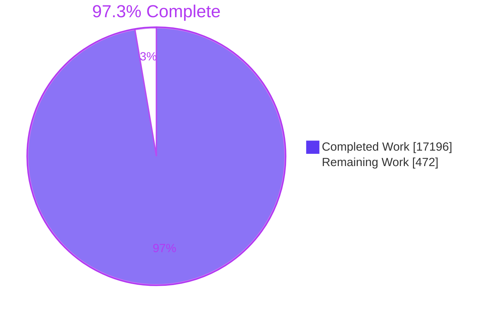
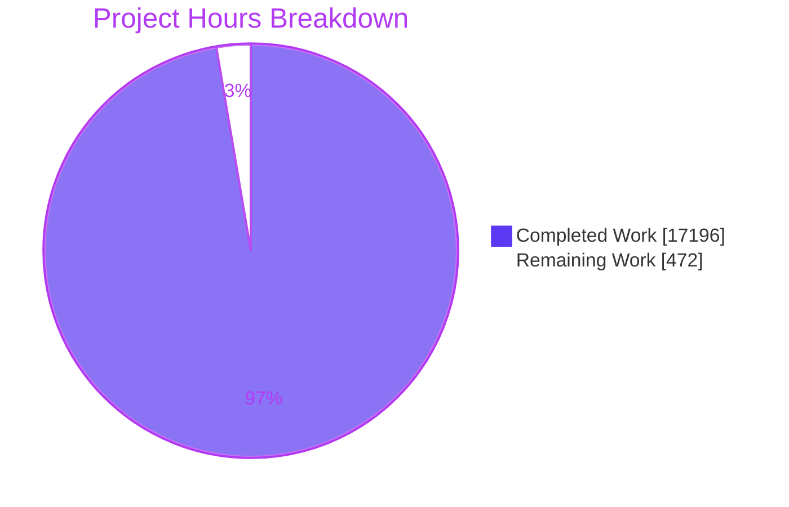
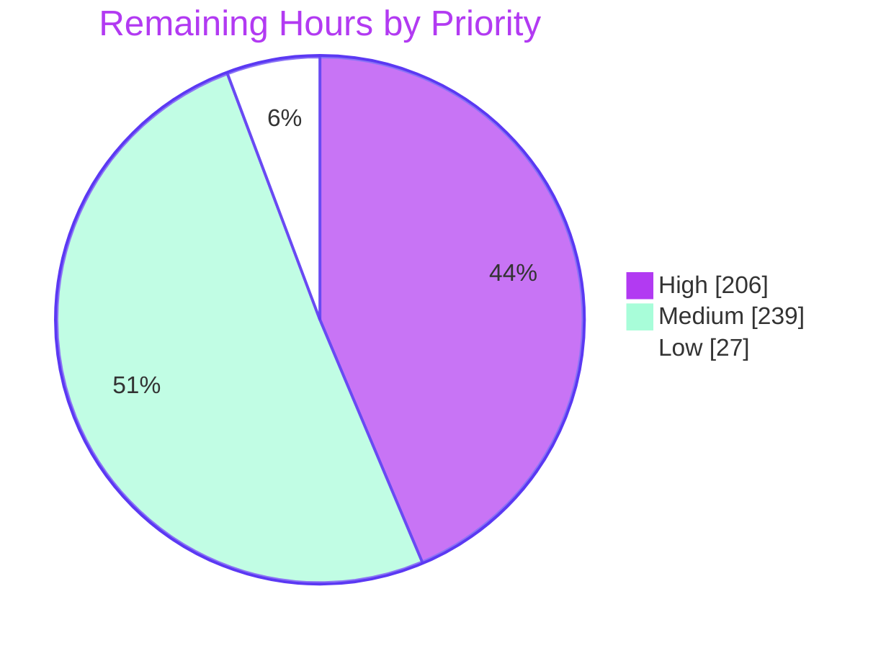

# 1. Executive Summary

## 1.1 Project Overview

Masa CMS 7.6.1 (Adobe ColdFusion 2023, SQL Server 2022) is migrating strangler-fig style to OPT-2: four Node.js 22/TypeScript domain services on PostgreSQL 16 (identity, people, programs-sites, strategies-content), with the platform proven on a stub service. A gateway routes each legacy route by a versioned cut-over table, with Pub/Sub events, OpenTelemetry tracing and a Google Cloud Terraform plan. The branch adds 3,124 files and 1,028,404 lines, 75.0% fewer than before its line-reduction pass, and modifies no file tracked at pin `696383140`. It delivers a platform library, gateway, Next.js admin UI, migration orchestrator and parity harness for Masa administrators and editors.

## 1.2 Completion Status



| Metric | Value |
|---|---|
| Total Hours | 17,668 |
| Completed Hours (Baseline: Human with agentic-assist) | 17,196 |
| Remaining Hours | 472 |
| Percent Complete | 97.3% |

17,196 hours completed out of 17,668 total hours = 97.3% complete (17,196 ÷ (17,196 + 472)). Only AAP-scoped, refine-requested and path-to-production work counts.

## 1.3 Key Accomplishments

- [x] 76,404 of 76,411 tests pass in 11 packages (0 failures, 7 configuration-gated skips), at 96.58–99.28% statement coverage
- [x] The PR is 75.0% smaller (4,111,335 → 1,028,404 inserted lines), and every kept behaviour gate holds
- [x] Additive-only: no pinned file changes; all 120 deliverables checked carry the pin SHA
- [x] From a fresh clone the stack boots (`harness/repro/up.sh` exit 0) and stages 0–9 pass
- [x] 20 of 21 golden scenarios at parity, none failing, same-run and against the committed sets
- [x] 18 reconciliations at zero difference, each reproducible from the committed archive
- [x] Tenant isolation, event delivery, trace propagation and the platform proof pass
- [x] Terraform plans 239 resources without apply; 0 HIGH/CRITICAL advisories; no secrets; the deck renders

## 1.4 Critical Unresolved Issues

**Open:**
- 2 of 41 acceptance items are unmet: 1 of 21 parity scenarios and 1 of 20 service-matrix cells (4 services × 5 columns).
- 1 of the 16 refine-request items, one commit per phase, is partly met.

The acceptance items wait for the owner to approve the 53 entries in `opt2/decision-list.md`, which the AAP forbids building before approval. The table groups the open work with exact counts. Section 5.2 details each item.

| Issue | Impact | Owner | ETA |
|---|---|---|---|
| 2 of 41 acceptance items withheld while 53 decision-list entries await approval | `harness/repro/test-all.sh` exits 2 and `opt2/reports/reproducibility.md` reads `fail`; GS-ID-09 stays served by legacy | Product owner | 24 h, plus implementation of what is approved |
| 7 divergences awaiting a human decision (Section 5.2 rows 4–10) | Parity and data-safety edge cases on reverse projection, feeds and content trees | Tech lead | 56 h |
| 13 open `preserve` exceptions | On these edge cases the target answers a legacy-shaped 503 where legacy serves a normal response | Tech lead | 52 h |
| 5 reproduced legacy security weaknesses whose fix proposals await acceptance | Weaknesses such as the unauthenticated reload key (`EX-SEC-APPRELOAD`) are live on carried routes | Security owner | Within the 16 h decision review |
| 53 of 70 measured latency sets above 1.5× legacy p95 | Content save takes about 1.45 s; write windows take up to 9 s | Performance owner | 32 h |
| 24 accepted follow-ups and caveats (Section 5.2 rows 11–12, 22–33, 35–37, 49–51, 53–56) | Minor behaviour, evidence and tooling differences | Engineering | 67 h |
| 19 deliverables built but never run: 7 cloud paths, 4 CI workflows, 8 container images | Cloud deployment is unproven | DevOps / Cloud | 131 h |
| Speed hours unavailable: `opt2/speed/blitzy-activity.json` records no activity bounds | Hours per 1,000 CFML lines are not computed | Engineering | 3 h |
| 2 refine items: Phases 2–4 are not ancestors of the PR head, and 11 re-derived golden baselines await acceptance (Section 5.2 rows 45–46) | Per-phase review is unavailable on the PR branch; 11 scenarios' committed baselines are post-removal captures | Repository owner | 3 h |

## 1.5 Access Issues

| System/Resource | Type of Access | Issue Description | Resolution Status | Owner |
|---|---|---|---|---|
| Google Cloud project | Deployment credentials and IAM | There is no project, credentials or `opt2-operator` service account, so `terraform apply` cannot run and cloud cut-over calls fail closed with IAM 403 | Open | Cloud owner |
| CI runner (GitHub Actions) | Workflow execution | `.github/workflows/{contracts,services,terraform,security}.yml` have never run on a runner | Open | DevOps |
| Container runtime | Docker build | The build host has no Docker; `services.yml` is the only place the 8 images are built | Open | DevOps |
| Identity Platform Web API key | Secret Manager secret | `OPT2_IDENTITY_PLATFORM_API_KEY` must be provided before cloud token exchange can work | Open | Security owner |
| PR branch on the origin repository | Write access | Restoring the phase-commit ancestry needs a merge pushed to the PR branch, or an authorised force-push | Open | Repository owner |

## 1.6 Recommended Next Steps

1. [High] Decide the 53 decision-list entries and the 5 fix proposals; rerun `harness/repro/clean-checkout-proof.sh` until it reaches exit 0.
2. [High] Settle the 7 divergences in Section 5.2 rows 4–10.
3. [High] Run the four CI workflows and build the 8 container images.
4. [High] Provision Google Cloud from `infra/terraform/envs/plan` and test the seven cloud paths.
5. [High] Merge `72e454980` into the PR branch with `-s ours`, and accept the 11 re-derived golden baselines.

# 2. Project Hours Breakdown

## 2.1 Completed Work Detail

Hours are estimated from delivered code volume, at these rates:
- TypeScript source: about 40 lines per hour, including design and debugging.
- Tests: about 80 lines per hour.
- CFML, SQL and shell: about 25 lines per hour.

Analysis, golden-data capture and full-stack acceptance runs are added on top. Rows that lost the six removed synthetic modules keep their hours, less the share of their code volume that the removal deleted, at these rates. The two refine rows are sized from what the line-reduction pass changed since the pre-refine head `60628e83c` (+23,088 / −3,106,019 lines), plus its per-phase gate runs. Confidence is medium.

| Component | Hours | Description |
|---|---|---|
| Legacy inventory, cloc, ownership, decision and exceptions lists | 1,080 | `harness/src/inventory` generates `opt2/inventory/legacy-inventory.{json,md}`: 25 circuits, 222 actions, 251 variants and 72 live tables. Also `cloc.{json,md}` (1,179 files, 228,839 lines), `opt2/table-ownership`, `opt2/decision-list` (53 entries) and `opt2/exceptions-list` (50 entries) (AAP 0.3, 0.4.3, 0.7.5) |
| Platform library `@opt2/platform` | 1,780 | 13 subpath modules: service-kit, auth, tenancy/RLS, outbox, events, logging, tracing, legacy-compat route keys, tasks, storage, migration-kit, state-machine and testing. Event-envelope, log-record and shared OpenAPI component contracts (AAP 0.4.1, 0.5.5) |
| Gateway, cut-over versions, session and CSRF continuity, legacy bridge | 1,010 | `gateway/src`: dispatcher, fail-closed 503s, freeze/epoch/in-flight tracking and session mapping. `gateway/cutover/versions/v0001–v0003.json` with validator and group builder. `gateway/legacy-bridge/cfml` HMAC-guarded bridge pages (AAP 0.4.2) |
| Web admin UI (Next.js 16.4.3) | 2,430 | 15 reproduced legacy admin circuits and the legacy shell markup, under `web/app` and `web/src/screens` (AAP 0.4.9) |
| Identity service | 1,130 | Login, groups, permissions, OAuth/REST, the token issuer and JWKS, CSRF ledger, role map and 13 schema migrations (`services/identity`) |
| People service | 1,030 | Roster, profiles, archive, and the people↔identity roster write protocol with recovery sweep (`services/people`, AAP 0.4.3) |
| Programs-sites service | 490 | Site settings and site monitor, with site registry reads (`services/programs-sites`) |
| Strategies-content service | 2,550 | Content tree, versions, approvals, change sets, feeds, forms, comments, files and the JSON API, with 18 migrations (`services/strategies-content`) |
| Stub service | 100 | Platform proof on one tenant-owned note: OpenAPI and event contracts, outbox, idempotent consumer, dead letters and tracing (`services/stub`, AAP 0.4.2, 0.5, 0.9) |
| Migration orchestrator | 2,050 | `migration/src`: snapshot, extract, backfill with baseline guard, change feed, reverse projector and barrier, write windows, transition, rollback, faults, reconciliation, `opt2-db` bootstrap, scheduler hand-off and quiesce (AAP 0.5, 0.8) |
| Golden parity harness and 22 golden sets | 990 | `harness/src/golden` capture, replay, normalise, compare and coverage; `harness/golden/catalogue.yaml`; `harness/golden/sets` (AAP 0.7.2–0.7.4) |
| Reproducibility, baseline, security, isolation, performance and check tooling | 1,664 | `harness/repro/{up,test-all,down,clean-checkout-proof}.sh`, the diagnostic baseline CFML, e2e suites, the authorisation matrix, isolation, event and speed outputs, check-pin, check-synthetic, check-reviewability and check-deck. Includes the full-stack acceptance runs and their live assumption checks (AAP 0.2.3, 0.7.1, 0.9) |
| Legacy fixtures and seed generator | 210 | `legacy-fixtures/{cfml,sql,seed}` and `load-fixtures.sh`: the people-archive oracle and the deterministic seed 20260601 with business date 2026-06-30 (AAP 0.7.6, 0.8.6) |
| Infrastructure, CI workflows, Dockerfiles | 170 | `infra/terraform`: 10 modules plus `envs/plan`, pinned to Terraform 1.17.1 and google 8.9.0. Four workflows and 8 Dockerfiles (AAP 0.4.6, 0.10.3) |
| Executive deck (Rule 1) | 32 | `opt2/executive-summary/index.html`, a 16-slide reveal.js deck with a scroll-view reading layout below 1,024 px (AAP 0.12.1) |
| Service documentation and traceability | 120 | A README, a `TRACEABILITY.md` and contracts for each service; `migration/runbooks/people-roster-rollback.md`; `opt2/reports/pre-existing-defects.md` (AAP 0.9.4, 0.11.1) |
| Refine: line reduction, Phases 1–4 | 264 | Four pieces of work, each with its tests (refine request lines 11–31):<br/>• Compact writers and a deep-equal rewrite of 308 JSON files.<br/>• Removal of 48 withheld and halted golden sets, through an explicit relinquished-cover list; reconciliation evidence held as one baseline plus 16 difference records, with `migration/src/reconcile/archive.ts`.<br/>• Removal of the six synthetic modules across 1,295 files, with the trace, seam, DLQ and isolation checks rebuilt on the stub.<br/>• 96 shared components in `platform/contracts/openapi-components.v1.yaml`, and shared test helpers in `platform/src/testing`. |
| Refine: hardening, behaviour gates and final report | 96 | Hardening across six areas, then the gates and the report (refine request lines 8 and 33):<br/>• Cut-over validate modes and load-time validation.<br/>• A bounded lenient login forward.<br/>• Strict authorisation-matrix verdicts.<br/>• A resumable transition abort, with rollback evidence bound to its run.<br/>• Golden replay of the rehearsal crossing, and escaped-origin normalisation.<br/>• The deck's narrow-screen layout.<br/>Before-and-after gates and full-stack runs for every phase, and the final report in commit `09c453eb0`. |
| **Total** | **17,196** | |

## 2.2 Remaining Work Detail

| Category | Hours | Priority |
|---|---|---|
| A. Decide the 53 decision-list entries and 5 security fix proposals (AAP 0.4.3, 0.7.4, 0.11.1) | 16 | High |
| B. Settle the 7 divergences awaiting a decision (hours):<br/>• reverse-projection datetime guard 12<br/>• quarantine operator path 16<br/>• case-insensitive siteid reads 12<br/>• OD-04 6<br/>• probe-not-target 4<br/>• NULL feedManager 4<br/>• fault placement 2 | 56 | High |
| G. Run the four CI workflows on a runner (AAP 0.10.3) | 16 | High |
| H. Build and smoke-test the 8 container images (AAP 0.4.1) | 7 | High |
| I. [Path-to-production] Provision Google Cloud: apply the 239-resource plan; `opt2-operator` service account with tokenCreator, IAM Credentials API and run.invoker; Secret Manager values | 60 | High |
| J. [Path-to-production] Live tests of 7 cloud paths: Identity Platform, invocation credentials, Cloud Tasks, v4 storage signing, Secret Manager, db-bootstrap job, OTel sidecar | 48 | High |
| Q. Restore the refine phase history: merge `72e454980` with `-s ours --no-ff`, then check the diff is empty and the ancestry holds (1). Review and accept the 11 re-derived golden baselines against `60628e83c` (2). Section 5.2 rows 45–46 | 3 | High |
| C. Close or reclassify the 13 open `preserve` exceptions (AAP 0.7.5; low confidence) | 52 | Medium |
| D. Accepted follow-ups and caveats (Section 5.2 rows 11–12, 22–33, 35–37, 49–51, 53–56), including one fresh full-stack run to regenerate the committed run evidence from a single run | 67 | Medium |
| K. [Path-to-production] Production-sized migration rehearsal, including confirmation of collation and time zone | 40 | Medium |
| L. [Path-to-production] Re-measure performance on a quiet host and in the cloud; address p95 findings (AAP 0.9.2) | 32 | Medium |
| M. Rerun `clean-checkout-proof.sh` to exit 0 once the decisions are implemented (AAP 0.9.1 criterion 6) | 8 | Medium |
| N. [Path-to-production] Security sign-off: next 16.4.3 and minimatch advisories, the local token verifier, `X-Forwarded-Host` at the edge, path-parameter guards, credential rotation | 16 | Medium |
| P. [Path-to-production] User acceptance of the admin screens with real editors | 24 | Medium |
| F. Refresh run-derived artefacts: speed activity bounds (AAP 0.9.5) | 3 | Low |
| O. [Path-to-production] Operational readiness: alerts, dashboards, readiness probes, DLQ and cut-over runbooks | 24 | Low |
| **Total** | **472** | High 206 · Medium 239 · Low 27 |

## 2.3 Completion Calculation

The requirement inventory has 63 items:
- R01–R44 from the AAP, as the refine request narrowed it to four services plus the stub;
- the 3 user rules;
- the 16 refine-request items D1–D16.

| Status | Count | Requirements |
|---|---|---|
| Completed | 57 | **AAP:** pin and additive-only delivery, source pin, cloc, inventory, live assumption checks, ownership and decision list, platform, gateway, session and bridge, four services and the stub, roster protocol, RLS and roles, contracts and events, outbox and DLQ, logging and tracing, deny-by-default auth, storage, state-machine library, Terraform, web UI, change log, gates and windows, diagnostic baseline, golden catalogue, normaliser, parity output, fixtures, snapshot and backfill, feed and transition, reverse projector, reconciliation, rollback rehearsal, seed, test gates, repro scripts, reviewability, version pins, pre-existing defects, synthetic labels, `.gitignore` layout.<br/>**Rules:** Rule 1 and Rule 2; Rule 3 is not applied, as AAP 0.12.3 and the refine request sanction.<br/>**Refine request:** the line metric; only PR-added files changed; per-phase gates; JSON compaction (D5–D10); golden evidence; reconciliation evidence; module removal; shared contracts; shared test parts; the final report |
| Partially Completed | 6 | CI workflows not run (90%); 13 open exceptions (80%); success criteria with exit 2 (85%); speed hours unavailable (75%); images never built (70%); one commit per phase (25%: Phase 1 only) |
| Not Started | 0 | — |

Completed hours 17,196 + remaining hours 472 = 17,668 total. 17,196 ÷ 17,668 = **97.3%**.

# 3. Test Results

Every count below was observed on the PR head, commit `fdd137f29`, on 2026-11-26:
- Each of the 11 packages was installed with `CI=true npm ci` and built, then lint, typecheck, `npm test`, `npm run test:contract` and `npm run test:security` were run.
- Each package ran against its own PostgreSQL database and Pub/Sub emulator project, with `OPT2_TEST_REQUIRE_PG=1` and `OPT2_TEST_REQUIRE_PUBSUB=1`, so no database or emulator case could skip silently.
- Every step exited 0.
- Coverage is vitest statement coverage.
- The legacy baseline ran on a clean per-checkout ColdFusion instance serving an archive of the same commit.

| Area / Category | Framework | Tests | Passed | Failed | Coverage | What This Proves |
|---|---|---|---|---|---|---|
| Platform library (`platform`) | Vitest | 10,347 | 10,346 (1 skipped) | 0 | 98.50% | Tenancy/RLS, outbox, events, auth, tasks, storage, contract loading and migration-kit primitives hold their contracts |
| Gateway and cut-over (`gateway`) | Vitest | 4,361 | 4,361 | 0 | 98.66% | Routing by cut-over version, fail-closed writes, validated version loading, and session and CSRF continuity behave as specified |
| Four domain services and stub (`services/*`) | Vitest | 37,865 | 37,864 (1 skipped) | 0 | 96.58–98.97% | Each service's routes, repositories, events and legacy-shaped responses match their contracts |
| Web admin UI (`web`) | Vitest | 9,025 | 9,025 | 0 | 99.28% | Reproduced admin screens render the legacy markup and form flows |
| Migration orchestrator (`migration`) | Vitest | 5,888 | 5,886 (2 skipped) | 0 | 97.92% | Snapshot, backfill, feed, reverse projection, windows, transition, rollback, reconciliation and the point archive are correct on real PostgreSQL |
| Harness and seed generator (`harness`, `legacy-fixtures/seed`) | Vitest | 8,925 | 8,922 (3 skipped) | 0 | 97.80% / 98.92% | Golden capture, normalise, compare and coverage, the repro and check tooling, and the deterministic seed are correct |
| Dedicated contract and security runs (11 and 10 packages) | Vitest | 16,672 | 16,672 | 0 | n/a | OpenAPI and event contracts, route-key parity, authorisation matrices and injection checks hold |
| Legacy CFML diagnostic baseline | TestBox | 683 | 662 | 21 | n/a | The legacy oracle matches its recorded baseline exactly (22 bundles, 0 errored), and the 21 failures are the expected ones |

**Totals:** the main suites of the 11 packages ran 76,411 tests: 76,404 passed, 0 failed, 7 skipped. The services split as follows: identity 7,093; people 5,357; programs-sites 2,352; strategies-content 22,028; stub 1,035. Each of the 7 skips runs only in another configuration:

| Package | Skips | Condition |
|---|---|---|
| `harness` | 3 | Two need a captured legacy ColdFusion server home with its JAI Image I/O codec plugins; one needs the seeded dataset in `$OPT2_STATE_DIR/seed` |
| `migration` | 2 | Dedicated-cluster `opt2-db bootstrap` cases (`OPT2_DEDICATED_PG=1`) |
| `platform` | 1 | Needs a BYPASSRLS-capable role, which the test login deliberately lacks |
| `services/strategies-content` | 1 | Complementary `runIf` case |

**Expected legacy results:**
- The 21 legacy failures: 19 entity VARCHAR/FLOAT datatype specs, one `beanFeedSecurity` timing spec and one `isPathLegal` alternate-theme spec.
- The official TestBox runner answers HTTP 500 with 0 specs, because `core/tests/specs/mura/core/bundleValidatorSecurity.cfc:36` does not compile on ACF.

**Static gates (observed on the PR head):**
- The pin diff (`--diff-filter=DMRT`) is empty.
- `check:pin`: ok, 120 checked, 0 findings.
- `check:synthetic`: ok, 40 labelled.
- `check:deck`: ok, 16 sections.
- `cutover:validate --ci`: ok for v0001–v0003, and `build-versions.ts` reports all three up to date.
- `migration/src/reconcile/archive.ts verify`: 18 of 18 points at zero difference.
- gitleaks: no leaks.
- osv-scanner: 0 HIGH/CRITICAL across 11 lockfiles.
- Terraform `fmt`, `validate` and `plan`: exit 0, 239 to add.

**Not Covered — test before release:**
- **Cloud adapters.** Identity Platform token exchange, service invocation credentials, Cloud Tasks, v4 signed storage URLs, Secret Manager, the db-bootstrap Cloud Run job and the OTel sidecar are tested only against recorded exchanges and local adapters. Test them in a provisioned project.
- **Event-to-task scheduling.** No kept flow schedules a Cloud Task from an event, so that seam has unit tests only.
- **CI and images.** The four GitHub workflows, with their 11-package matrices, and the 8 Docker image builds have never run.
- **Golden cover of moved routes.** 62 of the 74 routes v0002 moves to the target have no golden scenario (`harness/golden/relinquished-covers.json`). Only unit, contract and e2e tests cover them.
- **Legacy scheduled-task hand-off.** The baseline runs with `ping=false`, so no site-monitor task exists to hand off.
- **Untested write paths.** A successful `cform` import and a `cusers.addToGroup` write have not been exercised.
- **Long outages.** Transition-abort escalation during an outage of more than 5 minutes is unit-tested only.
- **Performance.** Latency was measured only on a heavily loaded shared host, never on a quiet host or in the cloud.
- **Process loss.** Eight stack-level process-loss combinations are not in the fault set.
- **Withheld routes.** The 40 withheld decision-list routes are deliberately not built, so they have no target tests.

# 4. Runtime Validation & UI Verification

The legacy and deck lines were driven on the PR head. The full-stack lines come from a fresh-clone run of commit `09c453eb0` (2026-11-26, on its own port block).

The three commits after `09c453eb0` touch only three things:
- a test-only clock;
- the golden normaliser and one golden set;
- the deck.

Each of those was verified by its package gate. The normaliser change was also verified by a committed-set compare on another port block, and the deck by a browser render.

- ✅ **Legacy oracle start-up.**
  - On a clean instance, the home page answers 200 and `/admin/` answers 302.
  - The diagnostic TestBox run matched its baseline exactly (683 specs).
- ✅ **Service start-up and schema bootstrap.**
  - `up.sh` bootstraps 7 schemas and 21 roles (`opt2-db bootstrap --target local`).
  - It starts the gateway, web, migration, the four services and the stub, each answering `/healthz` with 200 `{"status":"ok"}`.
  - Anonymous protected requests are refused (authorisation suite 8 of 8).
- ✅ **Executive deck.**
  - In Chromium at 375, 768, 1280 and 1920 px, all 16 slides render.
  - In scroll view the URL hash follows the displayed slide.
  - Title text reaches 10.94:1 and 13.60:1 contrast.
  - There are no console errors.
  - `check:deck -- --render` passes.
- ⚠ **Full-stack acceptance.**
  - `up.sh` exited 0 and all of `test-all.sh` stages 0–9 passed.
  - `test-all.sh` exited 2 with exactly 2 unmet items: GS-ID-09 withheld and the identity parity cell.
  - `down.sh` exited 0.
- ✅ **Admin UI through the gateway.** These were exercised at 375–1920 px with 0 console errors:
  - admin login and the empty-login error;
  - the dashboard;
  - Users search and row actions;
  - the Site Manager tree, list and components.

  Also verified: no OPT-2 navigation is shown, the GS-UI-04 flow replays, the HMAC-guarded session bridge passes 3 of 3, and 63 removed fixture, screen and action routes answer 404.
- ✅ **Golden parity.** 20 pass, 0 fail and GS-ID-09 withheld, both same-run and against the committed sets on a different port block.
- ✅ **Cut-over, rollback and data migration.**
  - 18 of 18 reconciliations show zero difference (backfill, feeds, 7 injected faults, cut-over, and before and after rollback).
  - The people-roster rollback suite passes 9 of 9.
- ✅ **Events, isolation and tracing.**
  - The seam (2/2) and DLQ (8/8) checks pass on the stub's note flow.
  - One trace spans the gateway server span, the stub server span (`POST /opt2/stub/notes`), its outbox publish and the stub consumer span (3/3).
  - Isolation: 5 checks pass, and 1 skips while its route is legacy-served.
  - The platform proof passes 8 of 8.
- ⚠ **Performance.**
  - All 16 suite checks pass.
  - p95 exceeds 1.5× legacy on 53 of 70 sets (`opt2/reports/performance.json`). 69 of those 70 sets are legacy-served in v0002, so their ratio measures the gateway's proxying.
  - Cold start is 1.3–1.4 s for the 4 services.
  - People's scale-to-zero timing is unavailable.
  - 8 write windows exceed 5 s.
- ❌ **Never exercised at runtime:**
  - every Google Cloud integration (Terraform was planned, never applied);
  - the CI workflows;
  - the container images;
  - legacy scheduled-task hand-off with a live task;
  - a full-stack run of the PR head's own tree.

# 5. Compliance & Quality Review

## 5.1 Compliance Matrix

| Deliverable | Benchmark | Status | Progress | Evidence |
|---|---|---|---|---|
| Additive-only change at the pin | No tracked file at `696383140` modified; the SHA is carried in every deliverable | ✅ Pass | 100% | The DMRT diff is empty; `check:pin` ok with 120 checked |
| 11 packages: build, lint, typecheck, tests and coverage | Exit 0 under Node 22.23.4 with `engine-strict`; ≥90% statements; contract and security suites | ✅ Pass | 100% | 76,404 of 76,411 pass, 0 failed, 7 configuration-gated skips; 96.58–99.28%; 2,638 contract and 14,034 security tests pass |
| Line-count reduction (refine request) | Fewer lines, no change in behaviour, one commit per phase | ⚠ Partial | 15 of 16 items; 75.0% fewer lines | `git diff --shortstat 696383140 HEAD`: 1,028,404 insertions; record in commit `09c453eb0`; Phases 2–4 not ancestors |
| Dependency and secret hygiene | 0 HIGH/CRITICAL; no leaks against the baseline | ✅ Pass (Medium open) | 95% | osv: Medium advisories only (`minimatch` 10.2.6, `next` 16.4.3); gitleaks clean |
| Infrastructure as code | fmt, validate and plan pass; no apply anywhere | ✅ Pass | 100% plan · 0% deployed | Plan of 239 resources; `terraform.yml` no-apply guard |
| Behavioural parity | Agreed scenarios pass, or are excepted or halted with an entry | ⚠ Partial | 20 of 21 pass; 0 halted; 1 withheld | `opt2/reports/parity.md`; 0 failing |
| Data consistency | Zero difference after every migration step | ✅ Pass | 18 of 18 | `opt2/reports/reconciliation/summary.md`; `archive.ts verify` |
| Isolation, events, observability, platform proof | Zero cross-tenant access; one trace from gateway to event consumer; 8 proof checks | ✅ Pass | 100% | `isolation.json`, `events.json`, `observability.json`, `platform-proof.json` |
| Reproducibility | `up.sh` 0 and `test-all.sh` 0 from a fresh clone | ⚠ Partial | Stages 0–9 pass; exit 2 | `opt2/reports/reproducibility.md`, `opt2/reports/test-all.md` |
| Reviewability and speed | README, TRACEABILITY and contracts per service; speed metrics labelled | ⚠ Partial | Reviewability 4 of 4; speed hours unavailable | `opt2/reports/reviewability.md`, `speed.md` |
| Exceptions and pre-existing defects | Every difference listed with a disposition | ⚠ Partial | 50 entries; 13 open `preserve` | `opt2/exceptions-list.md`, `opt2/reports/pre-existing-defects.md` |
| User rules | Rule 1 deck; Rule 2 terse docstrings; Rule 3 | ✅ Rule 1 · ✅ Rule 2 · Sanctioned Rule 3 | 100% / 100% / n/a | `check:deck` ok; reveal.js 5.1.0, Mermaid 11.4.0 and Lucide 0.460.0 pinned; no acceptance-criteria comments in the generated source files |

## 5.2 AAP & Rule Divergences and Gaps

| # | What the AAP/Rule Required | What Was Delivered Instead | Why It Diverged | Impact | Remediation |
|---|---|---|---|---|---|
| 1 | Rule 3 "WIP – Minimal Change 2" | Not applied; the line-reduction pass also reformats, deletes and de-duplicates | **Sanctioned:** AAP 0.12.3 says the rule does not bind a refactor run. The refine request explicitly asks for reformatting, deletion and de-duplication, which overrides the rule's reformat, fewest-files and interface clauses | None; no pinned file changes | None |
| 2 | `test-all.sh` exits 0, or 2 only when fixtures are unavailable (AAP 0.9.1 criterion 6) | Exit 2 with fixtures available; `opt2/reports/reproducibility.md` Status `fail` | 2 acceptance items are withheld until the 53 decision-list entries are approved; AAP 0.4.3 forbids building them first | Release acceptance cannot be signed | Decide the list, implement it, rerun the proof (tasks A, M) |
| 3 | AAP 0.3.2 expected `csettings.updatesite{action=update}` to carry | Legacy-served in v0001–v0003 (`gateway/cutover/versions/v0002.json` `entries[route="admin:csettings.updatesite{action=update}"]`) | **Sanctioned by AAP 0.3.2's computed-set rule:** the write set reaches `trazunasettings`, a decision-list table | Site settings saves stay on legacy | Part of the decision list (task A) |
| 4 | `window-import-interrupted` in stage 4 with the other faults (AAP 0.5.4, 0.9.3) | Runs in stage 6 after cut-over (`harness/repro/test-all.sh:84`) | v0001 has no target-authoritative unit to interrupt | None; the fault reconciles at zero difference | Confirm the placement (task B) |
| 5 | Scale-to-zero timing per service (AAP 0.9.2) | Unavailable for people (`opt2/reports/performance.md`) | The AAP 0.4.2 read rule keeps its reads on legacy in v0002/v0003, so the probe never reaches the target | Cold-path latency of people is unmeasured | Choose a target-read version or a direct probe (task B) |
| 6 | Reproduce legacy behaviour for client-credentials tokens (OD-04) | Legacy ACF answers 500, so no golden scenario proves OAuth token parity | No source settles whether to record an exception or reproduce the 500 | OAuth parity is undecided | Choose an exceptions entry or reproduction (task B) |
| 7 | Match legacy for a stored NULL `tsettings.feedManager` | Target answers 403 (`web/src/screens/cfeed/before.ts:8`); legacy answers 500 | A 403 was kept rather than reproducing a server error; no source settles it | Status code differs on corrupt data only | Accept or reproduce (task B) |
| 8 | Reverse projection writes only what legacy can store (AAP 0.8.3) | Datetimes below SQL Server's range are accepted, e.g. a change-set `publishDate` of 01/01/1000 returns 302 where legacy returns 500 | No 1753–9999 / smalldatetime guard was implemented in this run | Projection halts or legacy rejects the row | Add a storability guard (task B) |
| 9 | Target-only rows stay visible to legacy readers | Quarantined rows (`migration/db/migrations/0002_projector_quarantine.sql`) are invisible on legacy screens | No operator path to release or repair them was implemented in this run | Hidden rows until they are handled by hand | Build an operator path (task B) |
| 10 | Legacy siteid matching is case-insensitive | Content tree and lock reads match only the stored siteid spelling (`services/strategies-content/src/repo/content-queries.ts`) | Case-insensitive reads need an expression index or a collation choice the AAP leaves open | Mixed-case site URLs can miss rows | Decide the collation or index (task B) |
| 11 | Same | JSON API `siteCategoryAssignments` and feeds compare siteid exactly (`services/strategies-content/src/repo/repository.ts`) | Same cause as row 10 | As row 10 | Apply the row 10 decision (task D) |
| 12 | Same answer as legacy for any request head legacy accepts | Gateway returns 400 for heads within a few hundred bytes of legacy's 1 MiB limit, where legacy returns 200 | The added `X-Forwarded-*` and trace headers push the head over the shared limit | Only near-limit heads are affected | Raise legacy `MAX_HEADER_SIZE` or accept (task D) |
| 13 | A `preserve` exception closes once the target matches (AAP 0.7.5) | 13 entries open, e.g. `EX-ADMIN-DEBUGPAGE` and `EX-PROFILE-INTEREST-SITES` (`opt2/exceptions-list.md`) | Exact reproduction was not implemented in this run; the target fails closed with a legacy-shaped 503 | 13 edge cases are not at parity | Implement or reclassify (task C) |
| 14 | Reproduce legacy security weaknesses and propose fixes (AAP 0.11.1) | 5 open `fix` proposals, including the unauthenticated reload key `EX-SEC-APPRELOAD` | **Sanctioned:** AAP 0.11.1 and 0.7.5 require reproduce-and-propose | The weaknesses remain until a proposal is accepted | Decide each proposal (task A) |
| 15 | Session adoption per AAP 0.4.2 | `EX-ADOPT-SESSION-COOKIES` is an accepted `fix`: cookies differ from legacy at adoption | **Sanctioned:** the AAP 0.4.2 adoption design | Intentional difference | None |
| 16 | p95 at or below 1.5× legacy (AAP 0.9.2) | 53 of 70 sets above it (median 2.16×, maximum 16.63×); 69 of the 70 are legacy-served in v0002; content save about 1.45 s | **Accepted per AAP 0.9.2:** above 1.5× is a finding, not a failure. Two things drive the cost: the gateway's proxying of legacy-served reads, and the AAP 0.5.4 write windows with the 0.12.3 barrier waits | Slower requests through the gateway | Re-measure and tune (task L) |
| 17 | cloc unfiltered 1,243 files / 362,994 lines (AAP 0.3.1) | 1,350 / 368,039 measured; both figures stated in `opt2/inventory/cloc.md` | The AAP's figure also excludes `vendor` at any depth, `package-lock.json`, `*.min.js`, `*.min.css` and `*.map`. That planning basis measures 1,243 / 362,994, and `cloc.md` attributes the 107-file, 5,045-line gap | None | None |
| 18 | The generating run writes per-service activity bounds (AAP 0.9.5) | All bounds null in `opt2/speed/blitzy-activity.json`; hours `unavailable` in `opt2/reports/speed.md` | Not implemented in this run | Hours per 1,000 CFML lines are not computed | Supply run hours and regenerate (task F) |
| 19 | Assumptions A1–A5 verified and recorded (AAP 0.2.3) | `opt2/reports/assumptions.md` Status `complete`, A1–A5 `confirmed` with live evidence | `harness/repro/up.sh` step 12 runs `inventory:assumptions -- --live` after seeding | None | None |
| 20 | Each Dockerfile built (not pushed) in CI (AAP 0.4.1, 0.10.3) | 8 Dockerfiles, never built | No Docker on the build host (AAP conflict C6), and CI has not run | Image defects are unknown | Run `services.yml` (task H) |
| 21 | Cloud adapters | Recorded exchanges and local adapters only | **Sanctioned:** AAP 0.11.2 allows plan-only cloud | Cloud runtime is unproven | Live tests (tasks I, J) |
| 22 | Carried routes match legacy | `cPerm.main` with a malformed `contentid` returns 500 (`web/src/screens/cperm/main.ts`); legacy returns 200 | Known; the change was not implemented in this run | Edge-case status differs | Reproduce legacy (task D) |
| 23 | Same | Other screens that hit a TypeError render `core/templates/error.html`, not legacy's debug page | Known residual of `EX-ADMIN-DEBUGPAGE`; not implemented in this run | Error page differs | Task D |
| 24 | A refused write leaves its CSRF token usable | The token is consumed before the write-gate refusal | Known; the change was not implemented in this run | The user must reload the form | Reorder the checks (task D) |
| 25 | Logout matches legacy | Legacy logs out on any request carrying `logout`; the gateway detects logout by route key only (`gateway/src/session/resolve.ts`) | Left open as a follow-up; not implemented in this run | A target session may outlive a legacy logout variant | Task D |
| 26 | Every fault runs in every mode | `applier-killed-mid-batch` after a caught-up feed refuses with "run the deterministic legacy workload before this fault" | Left open as a follow-up; not implemented in this run | That combination is not exercised | Task D |
| 27 | Reloads complete before windows proceed | `migration/src/windows/reload.ts` and the forced-reinit fault reload without a completion check | Known; the change was not implemented in this run | A slow reload is not detected | Task D |
| 28 | Projection awaits wake the projector | Wake and demand act only on the local migration instance (`migration/src/reverse/projector.ts:1865`) | A cross-instance signal is needed; not implemented in this run | More than one instance falls back to poll cadence | Task D |
| 29 | Keyless batches applied once | The owner-side keyless apply in `platform/src/migration-kit/repository.ts` is unchanged; only the orchestrator refuses re-entry | Accepted caveat: the orchestrator is the only sender | A hand-sent batch can duplicate | Accept, or guard in the owners (task D) |
| 30 | Guards read every routing input | Path `params` sections (`doaction`, `locks`, `size`, `returnid`) are not read by guards or the page route key | Known; the change was not implemented in this run | Routing ignores these sections | Security review (task N) |
| 31 | `advancedsearch` matches legacy ordering | Java's tree-bin ordering in `rc.qs` is not modelled | Accepted as an edge case | Rare ordering difference | Accept or model it (task D) |
| 32 | The seed reaches every site | A Masa re-initialisation after site creation can commit the response early (`legacy-fixtures/cfml/seed.cfm`) | Accepted caveat; not hit in the acceptance run | Possible `up.sh` step-12 flake | Watch, retry (task D) |
| 33 | Health endpoints for operations | `/healthz` is liveness only (`platform/src/service-kit/create-service.ts:982`) | Readiness was not implemented in this run | Traffic may reach an instance that is not ready | Add readiness (task O) |
| 34 | Deck KPIs copied from `opt2/reports/*.json` (AAP 0.12.1) | Baseline, parity, reconciliation and run KPIs match the committed reports (`opt2/executive-summary/index.html`). Slide 9 states route-level cover: 11 of 74 moved routes are covered by passing scenarios, 1 only by withheld GS-ID-09, and 62 are accepted gaps | Taken from the current reports | None | None |
| 35 | Accessible deck controls | The teal progress bar is about 1.24:1 on white slides. Below the 1,024 px scroll-view threshold the overview is unavailable, and wide diagrams scroll sideways without a cue. Mermaid uses its default font | Accepted: the bar is an indicator, not a control; the rest is reveal.js 5.1.0 behaviour | Minor | Task D |
| 36 | Portable, accurate run outputs | Authz `HOOK_TIMEOUT_MS` is 45 min | Known; the change was not implemented in this run | Cosmetic and tooling | Task D |
| 37 | Rule 2: accurate, terse docstrings | Stale docstrings at `platform/src/legacy-compat/route-key.ts:260,497` | Known; the change was not implemented in this run | Misleading comments | Task D |
| 38 | Ten services, including the communications, reporting, surveys, timesheets, finance and e-signature modules on ports 8115–8120 (AAP 0.1.1, 0.4.1, 0.4.3) | The six modules are removed with every reference: their services, screens, fixtures, golden scenarios, cut-over entries, migration units, roles, queues, buckets, secret, Terraform resources and CI entries. Ports 8115–8120 are unassigned. Six legacy tables (`temails`, `temailstats`, `temailreturnstats`, `tmailinglist`, `tmailinglistmembers`, `tsessiontracking`) stay legacy-only | **Sanctioned:** refine request Phase 3 | Identity still produces `identity.login-mail.requested.v1`, and people `people.person.archived.v1`, with no subscriber. R and v0003 carry no `timesheets.blackout` | None |
| 39 | Every catalogue scenario replayed, with withheld and halted ones reported (AAP 0.7.2–0.7.4, 0.9.1) | 21 scenarios plus `harness/golden/sets/rehearsal/GS-ID-09.json` remain. The sets and catalogue entries of 39 withheld and 9 halted scenarios are removed, and `opt2/reports/parity.json` lists kept results only | **Sanctioned:** refine request Phase 2 | Acceptance falls from 140 items to 41, and unmet from 45 to 2 | None |
| 40 | `coverage.ts` fails when any v0002 target entry, reproduced admin action or legacy-write entry lacks a cover (AAP 0.7.2) | `harness/golden/relinquished-covers.json` relinquishes the 332 route keys whose only covers were removed scenarios (62 target, 212 legacy-write, 86 admin). Any other uncovered key still fails | **Sanctioned:** a consequence of the Phase 2 removal | 62 of the 74 moved routes rely on unit, contract and e2e tests rather than golden parity | Optional: capture scenarios for them |
| 41 | Full point reports under `opt2/reports/reconciliation/` (AAP 0.8.4) | One full baseline (`archive/after-fault-pubsub-redelivery.json`), 16 difference records, `rollback-before.json` and `summary.md`. `migration/src/reconcile/archive.ts build\|verify\|show` reconstructs each point | **Sanctioned:** refine request Phase 2 | None; `opt2-migrate reconcile` still writes full reports at run time | None |
| 42 | Each cut-over version is one immutable file (AAP 0.4.2) | `gateway/cutover/versions/v0001–v0003.json` and `groups.json` are regenerated: compact serialisation, new embedded inventory and ownership hashes, and no removed-module entries (819 entries each, 42 groups) | **Sanctioned:** refine request lines 17 and 28 | Every kept route keeps its state, kind, owning service and group | None |
| 43 | Each service has one self-contained `contracts/openapi.yaml` (AAP 0.4.4) | Seven contracts reference the 96 shared components in `platform/contracts/openapi-components.v1.yaml` by `$ref`; every dereferenced contract is deep-equal to its earlier form | **Sanctioned:** refine request Phase 4 | Generated types are byte-identical | None |
| 44 | Per-package contract and authorisation tests (AAP 0.9.2) | `test/helpers/app.ts`, `test/contract/openapi.test.ts` and `test/security/authz.test.ts` delegate to `@opt2/platform/testing`; test names and counts are unchanged | **Sanctioned:** refine request Phase 4 | None | None |
| 45 | One commit per phase, "Refine phase N: …" (refine request line 9) | Phase 1 is `2b41a5982`. Phases 2–4 were committed as `884c38332`, `bc528a0cf` and `b586aa9c7`, then reached the PR branch as one commit, `264a92a71`, combined with the changes that followed them. The empty commit `09c453eb0` restates each phase's record | The merge onto the PR branch collapsed the phase commits into one; rewriting the PR branch afterwards needs an authorised force-push | Per-phase review and bisect are unavailable on the PR branch; the tree is unaffected | Merge `72e454980` with `-s ours --no-ff` (task Q) |
| 46 | Values are never recaptured or edited, and `golden:compare` against the compacted sets stays at 0 failing (refine request lines 16 and 19) | In Phase 3, 11 kept sets (GS-ID-09, GS-PE-01, -02, -05, GS-PE-RH-01, -02, GS-CO-04, -16, GS-PUB-04, GS-UI-04 and the rehearsal set) were replaced with fresh captures, then re-derived with single-run values. The 8 JavaScript-escaped origins in `harness/golden/sets/GS-PE-05.json` were re-derived for the `javascript-escaped-host-port` rule. Same-run compares were 0-fail throughout; against the committed sets, Phases 2–4 recorded 31/10/1, 17/3/1 and 14/6/1 | Removing the modules changed the legacy output those captures held (retired role groups, rows written by removed scenarios). Several captures also held per-run values: bcrypt salts, bundle sha, search alerts, run-local ports | Verdicts are unchanged: 20 pass, 0 fail, 1 withheld against the committed sets on a different port block. 11 baselines are post-removal captures | Review the set changes against `60628e83c` and accept them (task Q) |
| 47 | v0001 stays byte-identical to what `up.sh` regenerates (refine request line 17) | `up.sh` no longer regenerates cut-over versions: every process reads the committed `gateway/cutover`, and `gateway/src/cutover/build-versions.ts` accepts only `--write`. The builder reports v0001–v0003 up to date | The fixtures-unavailable version set differed only in entries the module removal deleted, so that path and its 3 gateway tests were dropped | None; byte-identity is held by the builder and `cutover:validate --ci` | None |
| 48 | Expected package skips include 4 in harness (refine request line 8) | Harness skips 3 | **Sanctioned:** the fourth skipped case was an Admin-group check that left with removed scenarios GS-CO-09 and GS-BR-01, which the refine treats as a directed change | None | None |
| 49 | Exit codes are documented consistently (AAP 0.9.1; `opt2/README.md:16`) | The help text at `harness/repro/test-all.sh:41-42` and `EXIT_CODES['1']` at `harness/src/reporting/test-all.ts:73` list fewer exit-1 causes than the README | Not changed in this run | The help text understates exit 1 (interrupted run, unwritable report, failed matrix cell) | Align both texts with the README (task D) |
| 50 | Run reports come from the run they describe (AAP 0.9.4) | The committed `opt2/reports` combine two runs. Stages, service matrix, parity and performance come from the 2026-11-25 run. The append-only logs come from the 2026-11-21 run, pruned of the removed modules: `reconciliation/archive/`, `transitions.json`, `windows.json` and `rollback-rehearsal.md` (provenance line, `opt2/reports/test-all.md:10`). The stage-7 evidence list omits `opt2/exceptions-list.md` | The logs were pruned rather than regenerated, so each archived point stays reconstructible against its earlier report | Provenance spans two runs; every value verifies (`archive.ts verify`, 18 of 18) | Commit the outputs of one fresh full-stack run on a quiet host (task D) |
| 51 | Shared test parts and shared schemas move to `platform` (refine request line 31) | Still duplicated: about 140 inline response literals in other unit tests, two local TaskPort stubs, and contract blocks that differ only by service constants | The move covers the three named test files, and every dereferenced contract must stay deep-equal | Maintainability only | Optional consolidation (task D) |
| 52 | Checks that relied on a removed module are rebuilt with the same assertions (refine request line 28) | Trace, seam, DLQ and isolation checks run on the stub's note flow; the survey-to-Cloud-Tasks seam was not rebuilt | No kept flow schedules a Cloud Task from an event | Event-to-task scheduling has no runtime check | None until a kept service schedules tasks; Cloud Tasks itself is in task J |
| 53 | Golden masks cover only run-local values | The plain-origin rule treats `_` as a host boundary, so `not_localhost:<port>` becomes `not_<origin>` (`harness/src/golden/normalise/values.ts`) | Left unchanged, because the refine forbids behaviour changes; `_` is not valid in a host name | No current capture contains it | Accept or tighten (task D) |
| 54 | Admin head values encoded for their context | `themepath` is JavaScript-encoded; `htmlEditorType` and `context` are printed raw, as legacy prints them (`web/src/shell/html-head.ts:67-68`) | Kept to match legacy markup | Server-controlled settings only | Review with task N's sign-off (task D) |
| 55 | Lenient legacy login redirects forwarded as legacy sends them | The raw-`Location` forward is bounded per origin, and an all-escaped `Location` over about 0.53 MiB answers 503 (`gateway/src/dispatcher/lenient-response.ts`) | Accepted bound that keeps the forward memory-safe | Only pathological redirect headers are affected | Accept (task D) |
| 56 | Run outputs follow `OPT2_REPORTS_DIR` | The exceptions and parity Markdown follow it, but their footer links into `opt2/` do not resolve in a redirected run | Not changed in this run | Broken links in redirected copies only | Task D |
| 57 | The pin check exempts exactly one tracked file: the project guide, at its earlier per-run file name under `blitzy/documentation/` (refine request line 7) | `TRACKED_FORBIDDEN_EXCEPTIONS` names `blitzy/documentation/Project Guide.md` (`harness/src/reporting/check-pin.ts:92`) | The guide was renamed to the run-neutral path the branch history already used | None: still exactly one path, and `blitzy/screenshots/` and `themes/default/` stay forbidden | None |

**Row 2: release acceptance.** Both unmet acceptance items trace to `opt2/decision-list.md`, whose 12 tables, 40 action variants and 1 spanning controller are all marked "Approval is the user's decision". AAP 0.4.3 forbids building withheld items before approval, so `test-all.sh` must exit 2 until the owner decides. The items are GS-ID-09, which `opt2/reports/parity.json` withholds on `admin:cusers.update{type=2,action=delete}`, `page:render` and `admin:ceditprofile.update{extdata}`, and the identity parity cell it leaves unmet. The owner approves or rejects each entry, together with the five fix proposals in `opt2/exceptions-list.md`. The approved work is then implemented and `clean-checkout-proof.sh` rerun.

**Row 5: probe-not-target.** Under the read rule in AAP 0.4.2, people's reads stay legacy-authoritative in v0002 and v0003. The scale-to-zero probe therefore never reaches its target instance, and `opt2/reports/performance.md` records its scale-to-zero timing as unavailable. Cold start is measured for all four services (1.3–1.4 s), but scale-to-zero only for the other three. The decision: a version where those reads go to the target, or a direct probe that bypasses the gateway. Without one, people goes to production with an unmeasured cold path on Cloud Run's `min_instance_count = 0`.

**Row 6: OD-04 client credentials.** On this ACF, legacy cannot issue a `client_credentials` token and answers 500, while the identity service implements the flow. No golden scenario therefore proves OAuth token parity. The repository settles nothing between two options: reproduce legacy's 500, which keeps parity but leaves a broken flow, or record an `opt2/exceptions-list.md` entry that accepts the working target behaviour. The owner chooses one. The identity tests are then updated, and the OAuth scenario is captured again and checked with `golden:compare`.

**Row 7: NULL feedManager.** When `tsettings.feedManager` is stored as NULL, legacy fails with a 500 page. The target's `cfeedGate` (`web/src/screens/cfeed/before.ts:8`) answers 403 instead. The difference appears only with corrupt or hand-edited settings, but it is a status-code divergence on a carried route that no exceptions entry yet covers. The owner either accepts the 403 with an entry in `opt2/exceptions-list.md`, or the gate is changed to reproduce legacy's 500 page. The cfeed screen tests then pin whichever is chosen.

**Row 8: unstorable datetimes.** The reverse projector writes target rows back to SQL Server. The target accepts datetimes SQL Server cannot store: a change-set `publishDate` of 01/01/1000 is saved with a 302, where legacy answers 500. Once such a row is projected, the projection fails or the row is quarantined. A guard for the 1753–9999 `datetime` range, and the `smalldatetime` columns, belongs at the target's write boundary, tested against the legacy column types in `opt2/inventory/legacy-inventory.json`. About 12 hours.

**Row 9: quarantined rows.** Rows that legacy cannot accept go to the quarantine table created by `migration/db/migrations/0002_projector_quarantine.sql`. They stay on the target and are invisible on legacy screens while legacy is still authoritative for readers in that version. No operator command lists, repairs or releases them. Before production, an `opt2-ops` path is needed to inspect, repair and re-project or discard them, with an alert when the quarantine is not empty. About 16 hours.

**Row 10: siteid spelling.** Legacy SQL Server compares siteid case-insensitively. The target's content tree and lock reads, and the JSON API category assignments (row 11), compare the stored spelling exactly. A request whose site URL differs in case from the stored siteid therefore finds no rows on the target. The fix needs a decision: either a case-insensitive expression index on `lower(siteid)` with matching queries, or a non-deterministic collation. `COLLATE "C"` ordering also needs confirming against production data (task K).

**Row 45: phase history.** The refine asked for one commit per phase, so that each phase's line saving and gate record can be reviewed on its own. Phase 1 meets that (`2b41a5982`). Phases 2–4 exist as `884c38332` → `bc528a0cf` → `b586aa9c7`, but the PR branch carries them only as `264a92a71`. That commit's tree equals `72e454980`, the last descendant of the chain, and `git merge-base --is-ancestor b586aa9c7 HEAD` fails. The empty commit `09c453eb0` restates each phase's lines, gates, removed files and test attribution. To restore the ancestry without changing a file:
1. On the PR branch, run `git merge -s ours --no-ff 72e454980022118924adc231bad897a2e5d5a354`.
2. Confirm that `git diff HEAD^1 HEAD` is empty.
3. Push.

The alternative is to rebuild the history with an authorised force-push.

# 6. Risk Assessment

| Risk | Category | Severity | Probability | Mitigation | Status |
|---|---|---|---|---|---|
| Release acceptance stays blocked: 2 of 41 acceptance items wait on 53 pending decision-list entries, and the work they approve is not yet estimated | Technical | High | Certain until decided | Schedule the decision review first (task A); size the approved work before committing a date; rerun `clean-checkout-proof.sh` (task M) | Open |
| Cloud paths fail on first deployment: 7 adapters are proven only against recorded exchanges, and the `opt2-operator` service account does not exist, so cut-over calls fail closed with IAM 403 | Integration | High | High | Provision from `infra/terraform/envs/plan`; create the service account with tokenCreator and run.invoker; run live adapter tests in staging (tasks I, J) | Open |
| Reproduced legacy weaknesses stay live on carried routes, including the unauthenticated application reload key (`EX-SEC-APPRELOAD`) and site-scope checks on content and users | Security | High | Medium | Accept or reject the 5 fix proposals in `opt2/exceptions-list.md`; restrict the reload key at the edge until then (task A) | Open |
| Reverse projection meets data legacy cannot store: out-of-range datetimes, or target-only rows quarantined and invisible on legacy | Technical | Medium | Medium | Add a storability guard at the write boundary, plus an operator path and alert for quarantined rows (task B) | Open |
| Latency regression under production load: p95 is above 1.5× legacy on 53 of 70 sets, 69 of them proxied to legacy through the gateway. Content save takes about 1.45 s, and write windows up to 9 s | Technical | Medium | Medium | Re-measure on a quiet host and in Cloud Run; profile the gateway's legacy proxying; tune barrier waits and indexes; keep the 30 s window budget (task L) | Open |
| Moved routes regress unnoticed: 62 of the 74 routes v0002 moves to the target have no golden scenario since the withheld and halted evidence was removed | Technical | Medium | Low | Rely on the unit, contract and e2e suites; capture scenarios for the busiest of these routes before cut-over in production (task K) | Open |
| Operations blind spots: `/healthz` is liveness only, and projector wake works only on the local instance, so scaled-out migration falls back to polling. The four CI workflows and 8 container builds have never run | Operational | Medium | Medium | Add readiness probes, dashboards and DLQ alerts; run one migration instance or add a cross-instance signal; run `services.yml`, `contracts.yml`, `terraform.yml` and `security.yml` before merging (tasks D, G, H, O) | Open |
| Medium advisories in the pinned dependencies: `next` 16.4.3 (7 advisories, CVSS 6.0–6.9) and `minimatch` 10.2.6 (dev tooling) | Security | Medium | Low | Review exploitability; plan the `next` upgrade, which the AAP pin governs; keep osv-scanner in `security.yml` (task N) | Open |

# 7. Visual Project Status



Remaining work by priority (472 hours):



| Remaining category (Section 2.2) | Hours |
|---|---|
| D. Accepted follow-ups and caveats | 67 |
| I. Google Cloud provisioning | 60 |
| B. Divergences awaiting a decision | 56 |
| C. Open `preserve` exceptions | 52 |
| J. Live cloud-path tests | 48 |
| K. Production-sized migration rehearsal | 40 |
| L. Performance re-measurement | 32 |
| O, P. Operational readiness; user acceptance | 48 |
| A, G, H, M, N. Decisions; CI; images; proof rerun; security sign-off | 63 |
| F, Q. Speed refresh; refine history and baselines | 6 |
| **Total** | **472** |

# 8. Summary & Recommendations

The OPT-2 migration is 97.3% complete against its AAP and refine scope: 17,196 of 17,668 hours, with 472 hours remaining. The full target architecture is in the repository as 3,124 new files, and no file of the pinned Masa CMS 7.6.1 tree is changed. That architecture comprises:
- a platform library;
- a gateway with versioned cut-over;
- four domain services and a stub;
- a Next.js admin UI that reproduces the legacy screens;
- a migration orchestrator;
- a parity and reproducibility harness;
- a Terraform plan for Google Cloud.

The line-reduction pass cut the PR from 4,111,335 to 1,028,404 inserted lines (75.0%). It compacted the JSON, removed the six synthetic modules and the withheld and halted golden evidence, and shared the duplicated contracts and test helpers through `platform`. All 11 packages build, lint and type-check. 76,404 of 76,411 tests pass with no failures and 96.58–99.28% statement coverage. The legacy oracle still matches its diagnostic baseline exactly.

Verification runs end to end. From a fresh clone, `up.sh` boots legacy and the whole target stack, and `test-all.sh` passes all ten stages:
- 20 of 21 golden scenarios at parity with legacy, and none failing;
- 18 reconciliations at zero difference, through backfill, feeds, seven injected faults, cut-over and rollback;
- tenant isolation, event delivery, trace propagation and the platform proof, all passing on the stub and the four services.

The run still exits 2, for one reason by design. 2 of 41 acceptance items are withheld until the owner approves the 53 entries of `opt2/decision-list.md`, and the AAP forbids building them before that approval. Of the 16 refine-request items, 15 are met. One commit per phase holds for Phase 1 only, and a tree-neutral merge restores the rest.

The critical path to production has five steps:
1. **Decide.** The owner rules on the decision list and the five security fix proposals, and settles the seven divergences awaiting a decision (Section 5.2 rows 4–10).
2. **Settle the history.** Merge `72e454980` with `-s ours`, and accept the 11 re-derived golden baselines.
3. **Prove the pipelines.** Run the four CI workflows and build the 8 container images, none of which has run yet.
4. **Prove the cloud.** Apply the 239-resource plan, create the `opt2-operator` service account, and exercise the seven cloud paths so far proven only against recorded exchanges.
5. **Rehearse.** Run a production-sized migration, re-measure performance on a quiet host and in Cloud Run, and commit that run's evidence.

| Success metric | Target | Current |
|---|---|---|
| Acceptance items met | 41 of 41 | 39 of 41 |
| Refine-request items met | 16 of 16 | 15 of 16 |
| Parity scenarios at pass, excepted or halted | 21 of 21 | 20 of 21 (1 withheld) |
| Reconciliation differences | 0 | 0 across 18 runs |
| Failing tests | 0 | 0 of 76,411 |
| p95 within 1.5× legacy | All measured sets | 17 of 70 |
| HIGH/CRITICAL advisories | 0 | 0 |

**Production readiness:** not yet ready for production; ready for owner decisions and a staging deployment. The code base is verified internally to a high standard. What is missing is owner approval of the withheld scope, and first-time proof of the CI, container and cloud paths. The local evidence is strong enough for that work to begin now.

# 9. Development Guide

## 9.1 System Prerequisites

- **Operating system and memory.** Linux, with at least 8 GB of memory; SQL Server needs 2 GB of its own. Everything runs natively. Docker is not used locally: each `Dockerfile` is a Cloud Run artefact built in CI.
- **Node.js and npm.** Node.js **22.23.4** and npm 11.x. Every package pins `engines.node` and sets `engine-strict=true` and `save-exact=true` in its `.npmrc`.
- **Legacy oracle.**
  - Java 17 runs Adobe ColdFusion 2023 (2023.0.26) through CommandBox 6.x.
  - SQL Server 2022 Express is the legacy database, with `sqlcmd` 18 (always pass `-C`).
  - ColdFusion packages (cfpm): `sqlserver`, `image`, `mail`, `zip`, `feed`, `caching`, `orm`, `ajax`, `scheduler`.
- **Target tooling:**
  - PostgreSQL 16 on `127.0.0.1:5432`, with an admin role that has LOGIN, CREATEROLE and CREATEDB (no SUPERUSER, no BYPASSRLS);
  - the Google Cloud Pub/Sub emulator on `localhost:8085`;
  - the OpenTelemetry Collector (contrib), OTLP/HTTP on 4318;
  - Mailpit: SMTP 1025, API 8025.
- **Quality and infrastructure tools:** Terraform **1.17.1** (provider `hashicorp/google` 8.9.0, downloaded at init); gitleaks 8.30; osv-scanner 2.7; cloc 1.98; Playwright Chromium for the browser suites and `check:deck --render`.
- **Checkout rules.**
  - The repository root is the legacy web root.
  - Never place the checkout in a directory named `mura`; that name collides with a built-in ColdFusion mapping.
  - Never modify a file tracked at pin `696383140578f8dea3ece26f80cd7bfb370ddf0f`. Add new files only.

## 9.2 Environment Setup

These values are the single-owner defaults. They suit a host whose legacy ColdFusion server, SQL Server database, PostgreSQL cluster, Mailpit and Pub/Sub emulator project belong to this stack alone. The secrets come from your vault, never from the repository.

```bash
# Legacy Masa
export PORT=8080 MURA_DBHOST=127.0.0.1 MURA_DBPORT=1433 MURA_DATABASE=muradb MURA_DBUSERNAME=sa
export MURA_DATASOURCE=muradb MURA_DBTYPE=mssql MURA_DEFAULTHASHALGORITHM=CFMX_COMPAT MURA_ADMIN_USERNAME=admin
export MURA_DBPASSWORD='<secret>' MURA_ADMIN_PASSWORD='<secret>' MASA_TEST_EDITOR_PASSWORD='<secret>' CFCONFIG_ADMINPASSWORD='<secret>'
# Target tooling
export PG_HOST=127.0.0.1 PG_PORT=5432 PG_USER=masa_app PG_PASSWORD='<secret>' PG_DATABASE=masa_services
export PUBSUB_EMULATOR_HOST=localhost:8085 GOOGLE_CLOUD_PROJECT=opt2-local
export OTEL_EXPORTER_OTLP_ENDPOINT=http://127.0.0.1:4318   # OTLP/HTTP; 4317 is gRPC and is rejected
export OPT2_STATE_DIR="$HOME/.opt2/state" OPT2_PRISTINE_DIR="$HOME/.opt2/pristine" TZ=UTC
```

On such a host, start the tools:

```bash
ACCEPT_EULA=Y MSSQL_PID=Express MSSQL_SA_PASSWORD="$MURA_DBPASSWORD" sqlservr >sqlservr.log 2>&1 &
sqlcmd -S 127.0.0.1 -U sa -P "$MURA_DBPASSWORD" -C -Q "SELECT 1"          # repeat until it answers (≤ 2 min)
pg_isready -h "$PG_HOST" -p "$PG_PORT"
gcloud beta emulators pubsub start --host-port=localhost:8085 >pubsub.log 2>&1 &
otelcol-contrib --config harness/repro/otelcol-config.yaml >otelcol.log 2>&1 &
mailpit --smtp 127.0.0.1:1025 --listen 127.0.0.1:8025 >mailpit.log 2>&1 &
```

`harness/repro/up.sh` also starts some tools itself:
- SQL Server and PostgreSQL, when they do not answer (`OPT2_SQLSERVR_CMD`, `OPT2_PG_START_CMD`);
- the stack's own OTLP collector, on 4319;
- ColdFusion, through `harness/repro/lib/legacy-start.sh` and `harness/repro/server.json.template`, which carries the required `--add-opens` JVM arguments.

**Shared hosts.** What other people use is never this stack's:

- A ColdFusion server or legacy database that others use is a read-only oracle. GET pages and API routes, and log in, only: no data writes, no application reload, no TestBox and no restart. Never name it in `PORT`, `OPT2_LEGACY_SERVER_NAME` or `MURA_DATABASE`.
- A shared Mailpit is one mailbox for everyone. Never `DELETE /api/v1/messages` there, and filter by your own recipient.
- Never bootstrap on a shared PostgreSQL cluster: the `<schema>_owner`, `_app` and `_migrator` roles are cluster-global.

On a shared host, give the stack its own resources (§9.6 says why). Pass identical values, from one shell, to `up.sh`, `test-all.sh`, `down.sh` and `clean-checkout-proof.sh`.

Before anything of the stack starts (`masa-b` and `$STACK/pg` included), run the example below in that shell. It uses the port block 20100–20199, which also holds `PORT` and `PG_PORT`; check a port moved outside the block the same way.
- The example stops with the reason unless the whole block is free.
- It also stops unless both listeners of the Mailpit it starts belong to that process (`up.sh` never starts one).
- When both checks pass it reports `stack ready`. Run no stack command before then.
- `test-all.sh` and `clean-checkout-proof.sh` empty that Mailpit, so run `own_mailpit` just before each of them, and run them only if it passes.

```bash
B=20100 STACK="$HOME/opt2-b"   # example values; STACK lies outside the checkout
own_mailpit() {
  [ -n "${MAILPIT_PID:-}" ] && [ "$(lsof -t -iTCP:$((B + 25)) -sTCP:LISTEN) $(lsof -t -iTCP:$((B + 26)) -sTCP:LISTEN)" = "$MAILPIT_PID $MAILPIT_PID" ] ||
    { echo "Mailpit ports $((B + 25)) and $((B + 26)) do not both belong to pid ${MAILPIT_PID:-unset}" >&2; false; }
}
{ used="$(ss -Hltn "sport >= :$B and sport <= :$((B + 99))")" && [ -z "$used" ] ||
    { echo "ports $B-$((B + 99)) are not free; choose another B: $used" >&2; false; }; } &&
  mkdir -p "$STACK" && awk -F= -v b="$B" '/^OPT2_PORT_/ { print $1 "=" b + $2 - 8100 }' harness/repro/ports.env >"$STACK/ports.env" &&
  printf 'OPT2_TOOL_PORT_%s=%s\n' PUBSUB_EMULATOR $((B + 85)) OTLP_HTTP $((B + 41)) \
    MAILPIT_SMTP $((B + 25)) MAILPIT_HTTP $((B + 26)) >>"$STACK/ports.env" &&
  { mailpit --smtp 127.0.0.1:$((B + 25)) --listen 127.0.0.1:$((B + 26)) >"$STACK/mailpit.log" 2>&1 & MAILPIT_PID=$!; sleep 2; } &&
  own_mailpit &&
  export OPT2_PORTS_FILE="$STACK/ports.env" OPT2_STATE_DIR="$STACK/state" OPT2_PRISTINE_DIR="$STACK/pristine" \
    PORT=$((B + 80)) OPT2_LEGACY_SERVER_NAME=masa-b OPT2_CF_SERVER_NAME=opt2-legacy-b MURA_DATABASE=muradb_b \
    PG_HOST=127.0.0.1 PG_PORT=$((B + 32)) PG_DATABASE=masa_services GOOGLE_CLOUD_PROJECT=opt2-b \
    OPT2_PG_START_CMD="pg_ctl -D $STACK/pg -o '-p $((B + 32))' -l $STACK/pg.log start" OPT2_PG_STOP_CMD="pg_ctl -D $STACK/pg stop" \
    MAILPIT_API_URL="http://127.0.0.1:$((B + 26))" SMTP_HOST=127.0.0.1 SMTP_PORT=$((B + 25)) && echo "stack ready"
```

What the example assumes:
- **`masa-b`** is a CommandBox ColdFusion server of your own on `PORT`. Its webroot is this checkout, and it is installed on its own Masa database, `muradb_b`.
- **Its Masa file store** (`filedir`, by default inside this checkout) must be one no other server or checkout uses: `up.sh`, `test-all.sh` and `down.sh` empty it and extract saved copies into it.
- **Its mail settings** must all name `127.0.0.1:$((B + 25))`. That covers the ColdFusion mail server, which Masa uses while `usedefaultsmtpserver` is true, and every Masa `mailserverip` and `mailserversmtpport`, global or per site. The exported `SMTP_HOST` and `SMTP_PORT` route no Masa mail; they only name the listener that `legacy-fixtures/load-fixtures.sh` checks.
- **`$STACK/pg`** is a private PostgreSQL 16 cluster holding the §9.1 admin role and `PG_DATABASE`.

## 9.3 Dependency Installation

Install one package at a time. Every dependent package's `postinstall` runs `npm ci` and `npm run build` in `../platform`, so two installs in parallel race on `platform/node_modules`.

```bash
cd platform && CI=true npm ci && npm run build && cd ..
for pkg in gateway web migration harness legacy-fixtures/seed services/*; do
  (cd "$pkg" && CI=true npm ci) || break
done
```

The sequential install of all 11 packages, with their builds, takes about 4 minutes and exits 0. npm warns that `esbuild` has install scripts outside `allowScripts`; the warning is harmless.

## 9.4 Build and Test a Package

```bash
PGPASSWORD="$PG_PASSWORD" createdb -h "$PG_HOST" -U "$PG_USER" masa_services_dev   # a database of your own for package tests
cd gateway
npm run build            # generate contract types, then tsc (web: next build)
npm run lint && npm run typecheck
PG_DATABASE=masa_services_dev GOOGLE_CLOUD_PROJECT=opt2-dev OPT2_TEST_REQUIRE_PG=1 OPT2_TEST_REQUIRE_PUBSUB=1 \
  npm test -- --maxWorkers=2   # vitest --coverage, fails below 90% statements
npm run test:contract && npm run test:security   # platform has no test:security
```

Expected result: `gateway` passes 4,361 tests at 98.66% statements, with 144 contract and 503 security tests. Section 3 has the figures for every package. The 11 packages' full gates take about 15 minutes when run in three parallel lanes.

## 9.5 Run One Service Locally

`opt2-db bootstrap --target local` drops and recreates every OPT-2 schema, together with its fixed-name, cluster-global roles (`<schema>_owner`, `_app` and `_migrator`). Run it only when `PG_HOST` and `PG_PORT` name a cluster no one else shares; on a shared host, that is the private cluster of §9.2.

```bash
(cd harness && npm run repro:secrets)          # writes $OPT2_STATE_DIR/secrets (20 files)
OPT2_ENV=local node migration/dist/db-bootstrap/cli.js bootstrap --target local
#   -> {"command":"bootstrap","ok":true,"schemas":[...7...],"roles":21,"findings":[]}
cd services/identity
PORT=8111 OPT2_SERVICE_NAME=identity OPT2_ENV=local OPT2_DB_AUTH=password \
PG_USER=identity_app PG_PASSWORD="$(cat "$OPT2_STATE_DIR/secrets/db-identity-app")" \
OPT2_TOKEN_ISSUER=opt2-local-identity OPT2_TOKEN_AUDIENCE=opt2-local \
OPT2_JWKS_URL=http://127.0.0.1:8111/.well-known/jwks.json \
OPT2_GATEWAY_URL=http://127.0.0.1:8100 OPT2_MIGRATION_URL=http://127.0.0.1:8102 \
OPT2_SERVICE_URLS='{"identity":"http://127.0.0.1:8111","people":"http://127.0.0.1:8112","programs-sites":"http://127.0.0.1:8113","strategies-content":"http://127.0.0.1:8114"}' \
OPT2_TASKS_ADAPTER=local OPT2_STORAGE_ADAPTER=local nohup node dist/main.js >identity.log 2>&1 &
curl -s http://127.0.0.1:8111/healthz                 # {"status":"ok"}
curl -s http://127.0.0.1:8111/.well-known/jwks.json   # {"keys":[{"kty":"RSA",...}]}
```

- **Other services.** Each follows this pattern with its own `OPT2_SERVICE_NAME`, `<schema>_app` login and `OPT2_SERVICE_URLS` entries; each service's `README.md` lists them.
- **Ports.** Those shown are the single-owner defaults; on a shared host, use your own block.
- **Missing variables.** A service whose environment lacks a required variable refuses to start, naming the variable.
- **Stopping.** Stop a service by the pid that owns its port: `kill $(lsof -t -iTCP:8111 -sTCP:LISTEN)`.

## 9.6 Full Stack: Boot, Accept, Tear Down

On a shared host, first give the stack the isolated resources of §9.2, because the scripts change what they find:
- `up.sh` stops the ColdFusion server on `PORT`. It takes and restores the pristine baseline of `MURA_DATABASE` and of Masa's file store. It drops and recreates every OPT-2 schema and the fixed roles on `PG_HOST:PG_PORT`.
- `test-all.sh` deletes every message in the Mailpit named in the port file.
- `down.sh` restores the database and file store, and restarts the original server.

Run all four commands with the same values.

```bash
harness/repro/up.sh --help          # prints the required environment
harness/repro/up.sh                 # 0 = stack up (legacy on $PORT; gateway, web, migration, services and stub on the port file's ports)
harness/repro/test-all.sh           # stages 0–9; currently exits 2 (2 items withheld pending decisions)
harness/repro/down.sh               # stops everything and restores legacy from the pristine baseline
harness/repro/clean-checkout-proof.sh   # fresh clone: up.sh + test-all.sh, writes opt2/reports/reproducibility.md
```

- **Cut-over versions.** Every process reads the committed versions in `gateway/cutover`.
- **Run lock.** Every command takes `${OPT2_LOCK_DIR:-$HOME/.opt2}/run.lock`, which serialises stacks but isolates none of their resources. Set `OPT2_LOCK_WAIT=<seconds>` to queue instead of refusing.
- **Duration.** A full `test-all.sh` run takes about 122 minutes; stage 7 alone takes about 91 minutes.
- **Outputs.** Stage outputs go to `${OPT2_STATE_DIR}/test-all/stage-<n>.{json,out}`, and the summary to `opt2/reports/test-all.{json,md}`. A run rewrites tracked golden sets and reports in its checkout; review them with `git status` and keep only what is intended.
- **Ports.** `harness/repro/ports.env` serves a single-owner host only. On a shared host the stack needs its own `OPT2_PORTS_FILE`, which moves every `OPT2_PORT_*` and `OPT2_TOOL_PORT_*` key, plus the other §9.2 values (`harness/README.md`, "One stack at a time").

## 9.7 Verification and Quality Gates

```bash
git diff --name-only --diff-filter=DMRT 696383140578f8dea3ece26f80cd7bfb370ddf0f   # must print nothing
(cd harness && npm run check:pin && npm run check:synthetic && npm run check:deck -- --render)
(cd gateway && npm run cutover:validate -- --ci && npx tsx src/cutover/build-versions.ts)   # "v0001–v0003 up to date"
(cd migration && npx tsx src/reconcile/archive.ts verify)   # 18 points, zero difference
(cd harness && npm run golden:coverage)    # needs the seeded dataset in $OPT2_STATE_DIR/seed; unseeded it exits 1 with 11 unresolved-seed-ref only
git archive HEAD | tar -x -C "$SCRATCH" && (cd "$SCRATCH" && gitleaks dir . --config harness/security/gitleaks.toml \
  --baseline-path harness/security/gitleaks-baseline.json --redact --exit-code 1 --no-banner)
osv-scanner scan source -L gateway/package-lock.json          # repeat per lockfile; pass = 0 HIGH/CRITICAL
cd infra/terraform && terraform fmt -check -recursive
TF_DATA_DIR="$SCRATCH/tfdata" terraform -chdir=envs/plan init -backend=false -input=false -lockfile=readonly
TF_DATA_DIR="$SCRATCH/tfdata" terraform -chdir=envs/plan validate
TF_DATA_DIR="$SCRATCH/tfdata" terraform -chdir=envs/plan plan -input=false -refresh=false -lock=false \
  -var-file=plan.tfvars -out="$OPT2_STATE_DIR/tfplan"     # "Plan: 239 to add, 0 to change, 0 to destroy." Never apply.
```

`$SCRATCH` is any directory outside the checkout. For the legacy CFML baseline, run `npm run baseline:run` and then `npm run baseline:compare` in `harness`, on a ColdFusion instance of your own. The expected result is 22 bundles, 683 specs, 662 passed, 21 failed and 0 errored. The official `core/tests/runner.cfm` answers HTTP 500 by design.

## 9.8 Example Usage

```bash
curl -s -o /dev/null -w '%{http_code}\n' "http://localhost:${PORT}/"         # 200: legacy home page
curl -s -o /dev/null -w '%{http_code}\n' "http://localhost:${PORT}/admin/"   # 302 to the admin login
curl -s http://127.0.0.1:8199/healthz                                        # stub: {"status":"ok"}
curl -s -o /dev/null -w '%{http_code}\n' http://127.0.0.1:8199/opt2/stub/notes   # 401: deny-by-default
(cd harness && npm run test:e2e -- isolation/platform-proof)                 # with the stack up: writes opt2/reports/platform-proof.json
```

## 9.9 Troubleshooting

- **Tests skip, or coverage drops below 90%.** On a loaded host, the PostgreSQL and emulator probes give up after 2 s. Set `OPT2_TEST_REQUIRE_PG=1` and `OPT2_TEST_REQUIRE_PUBSUB=1` to fail fast, then rerun.
- **TypeScript errors in a dependent package after a platform change.** A stale `platform/dist` causes them. Run `npm run build --prefix platform` first; if stale build output persists, rerun `CI=true npm ci && npm run build` in the package.
- **No spans arrive.** The OTLP/HTTP exporters need port 4318. Sent to 4317, which is gRPC, they fail.
- **`up.sh` refuses to start.** Either a port in `ports.env` is in use or equals `$PORT`, or another checkout holds `run.lock`. Run that checkout's `down.sh` only if its stack is yours; otherwise wait with `OPT2_LOCK_WAIT`.
- **`test-all.sh` refuses to start after an interrupted run.** Background work is still suspended. Run `down.sh`, then `up.sh`.
- **Install-time failures.**
  - The first Masa install fails with "The '' algorithm is not supported": export `MURA_DEFAULTHASHALGORITHM=CFMX_COMPAT` before ColdFusion starts.
  - The home page fails with `InaccessibleObjectException` in `core/mura/moment.cfc`: the `--add-opens=java.base/sun.util.calendar=ALL-UNNAMED` JVM argument is missing from `server.json`.
- **Masa redirects `127.0.0.1` with a 301.** Use `localhost` for legacy URLs.
- **Tracked files changed by a check.**
  - `check:reviewability` rewrites the tracked placeholders `opt2/reports/reviewability.{json,md}`. Run it with `--no-write`, or restore them with `git checkout -- opt2/reports/reviewability.*`.
  - Validating a single Terraform module writes an untracked `.terraform.lock.hcl`; delete it.
- **Never commit generated or environment files:** `server.json`, `config/settings.ini.cfm`, `plugins/`, `node_modules`, `dist`, `.next`, `coverage`, `src/generated`, `themes/default/` or `blitzy/` (`blitzy/documentation/Project Guide.md` excepted).

# 10. Appendices

## A. Command Reference

| Command | Where | Purpose |
|---|---|---|
| `CI=true npm ci` · `npm run build` | each package | Install exactly from the lockfile; generate contract types, then compile |
| `npm test` · `npm run test:contract` · `npm run test:security` | each package | Vitest with coverage (≥90% statements); contract suites; authorisation and injection suites |
| `npm run lint` · `npm run typecheck` | each package | ESLint; `tsc` without emit over sources and tests |
| `npm run test:e2e -- <suite>` | `harness` | One full-stack e2e suite, for example `isolation/platform-proof` (needs `up.sh`) |
| `npm run check:pin` · `check:synthetic` · `check:reviewability` · `check:deck -- --render` | `harness` | Pin and SHA check; SYNTHETIC labels; README/TRACEABILITY/contracts per service; executive deck |
| `npm run golden:capture` · `golden:replay` · `golden:compare` · `golden:coverage` | `harness` | Record legacy, replay against the target, compare into `opt2/reports/parity.{json,md}`, check catalogue coverage |
| `npm run inventory` · `inventory:cloc` · `inventory:assumptions` | `harness` | Regenerate `opt2/inventory/*` and `opt2/reports/assumptions.md` (`-- --live` for live evidence) |
| `npm run repro:secrets` · `repro:cutover -- status` | `harness` | Generate local secrets; show or activate the cut-over version |
| `npm run cutover:validate -- --ci` · `cutover:versions` · `cutover:groups` | `gateway` | Validate and rebuild `gateway/cutover/{versions,groups.json}` |
| `npx tsx src/reconcile/archive.ts build\|verify\|show` | `migration` | Build, verify or show the committed reconciliation points from the baseline and difference records |
| `node migration/dist/db-bootstrap/cli.js bootstrap\|teardown --target local` | root | `opt2-db`: create or drop every OPT-2 schema and role |
| `node migration/dist/cli.js <command>` | root | `opt2-migrate`: snapshot, backfill, feed, transition, rollback, reconcile, fault, window report |
| `node migration/dist/quiesce/cli.js drain-and-suspend\|resume` | root | `opt2-ops`: quiesce and resume background work |
| `harness/repro/up.sh` · `test-all.sh` · `down.sh` · `clean-checkout-proof.sh` | root | Boot, accept, tear down, prove from a fresh clone |
| `infra/terraform/plan.sh` | root | `fmt`, `validate` and `plan`; never `apply` |

## B. Port Reference

These are the single-owner defaults:
- Every row except legacy, SQL Server, PostgreSQL and the host collector comes from `harness/repro/ports.env`.
- A stack on a shared host moves those rows together through its own `OPT2_PORTS_FILE`, and sets `PORT` and `PG_PORT` itself (§9.2).
- Ports 8115–8120 are unassigned. `harness/src/repro/ports.ts` rejects any port variable that names no kept package.

| Process | Port | Process | Port |
|---|---|---|---|
| gateway | 8100 | strategies-content | 8114 |
| web (Next.js) | 8101 | stub | 8199 |
| migration | 8102 | legacy ColdFusion | `${PORT}` (8080) |
| identity | 8111 | SQL Server / PostgreSQL | 1433 / 5432 |
| people | 8112 | Pub/Sub emulator | 8085 |
| programs-sites | 8113 | Mailpit SMTP / API | 1025 / 8025 |
| Host OTel Collector (gRPC / HTTP) | 4317 / 4318 | Stack OTel Collector (HTTP) | 4319 |

## C. Key File Locations

| Path | Contents |
|---|---|
| `platform/src/`, `platform/contracts/` | The 13 `@opt2/platform` subpath modules; event-envelope, log-record and shared OpenAPI component contracts |
| `gateway/src/`, `gateway/cutover/versions/v000{1,2,3}.json`, `gateway/legacy-bridge/cfml/` | Gateway, cut-over tables, legacy bridge pages |
| `services/<name>/` | Each service: `src/`, `test/`, `db/migrations/`, `contracts/`, `README.md`, `TRACEABILITY.md`, `Dockerfile` |
| `web/app/`, `web/src/screens/` | Next.js routes; reproduced legacy screens |
| `migration/src/`, `migration/runbooks/people-roster-rollback.md` | Migration orchestrator; rollback runbook |
| `harness/src/`, `harness/golden/`, `harness/repro/`, `harness/e2e/` | Harness code, catalogue, golden sets and relinquished covers, repro scripts, full-stack suites |
| `legacy-fixtures/{cfml,sql,seed}/` | SYNTHETIC people-archive legacy oracle and seed generator (`seed/seed.config.json`) |
| `infra/terraform/{modules,envs/plan}/` | 10 Terraform modules and the plan composition |
| `.github/workflows/` | `contracts.yml`, `services.yml`, `terraform.yml`, `security.yml` |
| `opt2/decision-list.md`, `opt2/exceptions-list.md`, `opt2/table-ownership.md` | Decisions awaiting the owner, exceptions, table ownership |
| `opt2/reports/` | Parity, reconciliation (baseline, difference records and summary), isolation, events, observability, performance, reproducibility and test-all outputs |
| `opt2/executive-summary/index.html` | The executive deck |

## D. Technology Versions

| Technology | Version | Technology | Version |
|---|---|---|---|
| Node.js | 22.23.4 | TypeScript | 5.9.3 |
| Next.js | 16.4.3 | Fastify | 5.12.7 |
| PostgreSQL | 16 | Terraform / google provider | 1.17.1 / 8.9.0 |
| Adobe ColdFusion | 2023 (2023.0.26) | SQL Server | 2022 Express |
| CommandBox | 6.x | Java (ColdFusion) | 17 |
| reveal.js / Mermaid / Lucide | 5.1.0 / 11.4.0 / 0.460.0 | Masa CMS (legacy) | 7.6.1 at `696383140` |

## E. Environment Variable Reference

| Variable | Used by | Purpose |
|---|---|---|
| `PORT`, `MURA_DBHOST`, `MURA_DBPORT`, `MURA_DATABASE`, `MURA_DBUSERNAME`, `MURA_DBPASSWORD` | legacy, `up.sh` | Legacy ColdFusion port and SQL Server database |
| `MURA_ADMIN_USERNAME`, `MURA_ADMIN_PASSWORD`, `MASA_TEST_EDITOR_PASSWORD`, `CFCONFIG_ADMINPASSWORD` | `up.sh`, `test-all.sh` | Legacy admin, `qa_editor` and ColdFusion Administrator credentials |
| `MURA_DEFAULTHASHALGORITHM=CFMX_COMPAT`, `MURA_TESTBOX` | legacy | Required for first install; enables TestBox |
| `PG_HOST`, `PG_PORT`, `PG_DATABASE`, `PG_USER`, `PG_PASSWORD` | services, tests, `opt2-db` | PostgreSQL; services log in as `<schema>_app` |
| `PUBSUB_EMULATOR_HOST`, `GOOGLE_CLOUD_PROJECT` | services, tests | Pub/Sub emulator and its project |
| `OTEL_EXPORTER_OTLP_ENDPOINT` | every process | OTLP/HTTP endpoint (`http://127.0.0.1:4318`) |
| `OPT2_SERVICE_NAME`, `OPT2_ENV`, `OPT2_DB_AUTH`, `OPT2_SERVICE_URLS` | services | Identity, environment, database auth mode, service map (required) |
| `OPT2_TOKEN_ISSUER`, `OPT2_TOKEN_AUDIENCE`, `OPT2_JWKS_URL` | services | Local token verification against identity's JWKS |
| `OPT2_GATEWAY_URL`, `OPT2_MIGRATION_URL`, `LEGACY_ORIGIN`, `OPT2_CUTOVER_DIR`, `OPT2_BRIDGE_HMAC_KEY` | gateway, services | Gateway and migration addresses, legacy origin, cut-over table directory (`up.sh` leaves it unset, so the committed `gateway/cutover` is read), bridge key |
| `OPT2_STATE_DIR`, `OPT2_PRISTINE_DIR`, `OPT2_REPORTS_DIR`, `OPT2_PORTS_FILE`, `OPT2_LOCK_DIR`, `OPT2_LOCK_WAIT` | harness scripts | State, pristine baseline, outputs, ports and run lock |
| `OPT2_TASKS_ADAPTER`, `OPT2_STORAGE_ADAPTER` | services | `local` adapters for Cloud Tasks and Cloud Storage |
| `OPT2_TEST_REQUIRE_PG`, `OPT2_TEST_REQUIRE_PUBSUB`, `OPT2_DEDICATED_PG` | tests | Fail rather than skip when the dependency is absent; run the dedicated-cluster bootstrap cases |
| `OPT2_IDENTITY_PLATFORM_API_KEY`, `CLOUD_SQL_INSTANCE`, `OPT2_CLOUDSQL_ADMIN_PASSWORD` | cloud only | Identity Platform key, Cloud SQL instance, bootstrap admin password |
| `TZ=UTC` | every process | Matches the legacy time zone |

## F. Developer Tools Guide

- **Change a cut-over route.** Edit the group or version source in `gateway/src/cutover/`, then run `npm run cutover:versions` and `npm run cutover:validate -- --ci` in `gateway`. Then run the `migration` unit tests, which read the committed versions.
- **Add a golden scenario.**
  1. Add it to `harness/golden/catalogue.yaml`, and capture it against legacy with `golden:capture`.
  2. Replay and compare it with the stack up.
  3. Remove any key it now covers from `harness/golden/relinquished-covers.json`.
  4. Confirm that `golden:coverage` shows 0 findings on the seeded dataset.
- **Add a schema migration.** Add `services/<name>/db/migrations/NNNN_<name>.sql`; `opt2-db bootstrap` picks it up by its name pattern. RLS must be `ENABLE` and `FORCE` on every tenant table.
- **Share an OpenAPI component.** Add it to `platform/contracts/openapi-components.v1.yaml` and reference it by same-name `$ref`. `loadOpenApiDocument` inlines it, and every dereferenced contract must stay deep-equal to its earlier form.
- **Diagnose a parity difference.** Read `opt2/reports/parity.md` and the replay under `${OPT2_STATE_DIR}/golden/replay/`. Masks belong only in `harness/golden/normalise.yaml`.
- **Trace a request.** Run a private collector, `otelcol-contrib --config harness/repro/otelcol-config.yaml`, and read `${OPT2_STATE_DIR}/otel/traces.jsonl`.

## G. Glossary

| Term | Meaning |
|---|---|
| OPT-2 | The target platform: Node.js services on PostgreSQL behind the gateway |
| Strangler fig | Incremental replacement in which the gateway moves routes from legacy to target one group at a time |
| Cut-over version (v0001–v0003) | A table mapping each legacy route key to `legacy`, `target` or `legacy-write`; v0002 is the cut-over, v0003 the people-roster rollback |
| Route key | The normalised identity of a legacy request (`admin:<circuit>.<action>{variant}`, `api:`, `rest:`, `page:`) |
| Golden set | A recorded legacy request/response pair, replayed against the target for byte-level parity |
| Relinquished cover | A route key whose only golden cover was a removed scenario, listed in `harness/golden/relinquished-covers.json` so that coverage still fails on any other uncovered key |
| Withheld | Scope awaiting owner approval in `opt2/decision-list.md`; legacy keeps serving it |
| Halted exception | An edge case kept on legacy in every cut-over version, recorded in `opt2/exceptions-list.md` |
| Open `preserve` exception | An edge case where the target answers a legacy-shaped 503 until it matches legacy exactly |
| Reverse projection | Writing target-authoritative changes back to SQL Server so legacy readers stay consistent |
| Write window | A short freeze during which a unit's authority moves between legacy and target |
| Reconciliation | Zero-tolerance, row-by-row comparison of legacy and target data in canonical form |
| SYNTHETIC | Label on the files under `legacy-fixtures/`, which have no Masa equivalent: the people-archive oracle and the seed loader |
